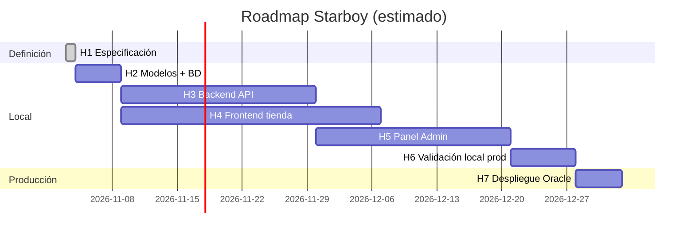
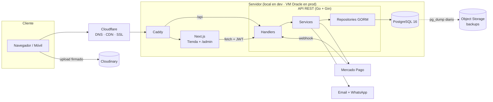
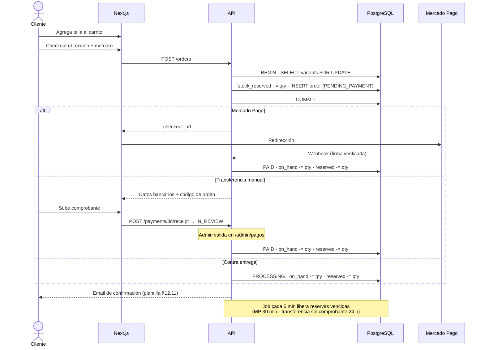
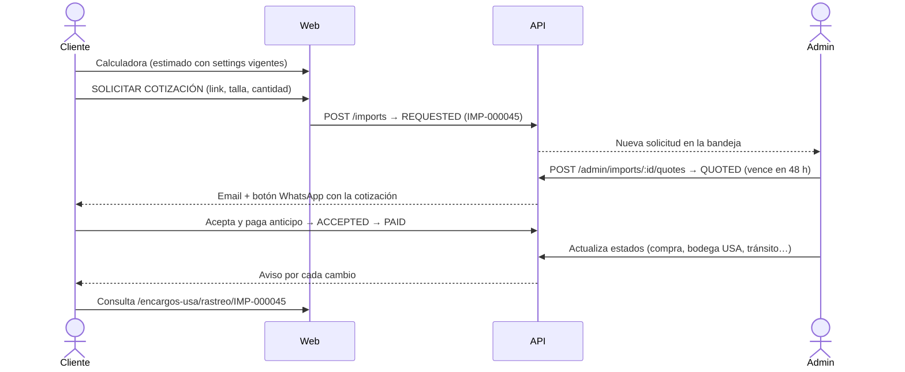
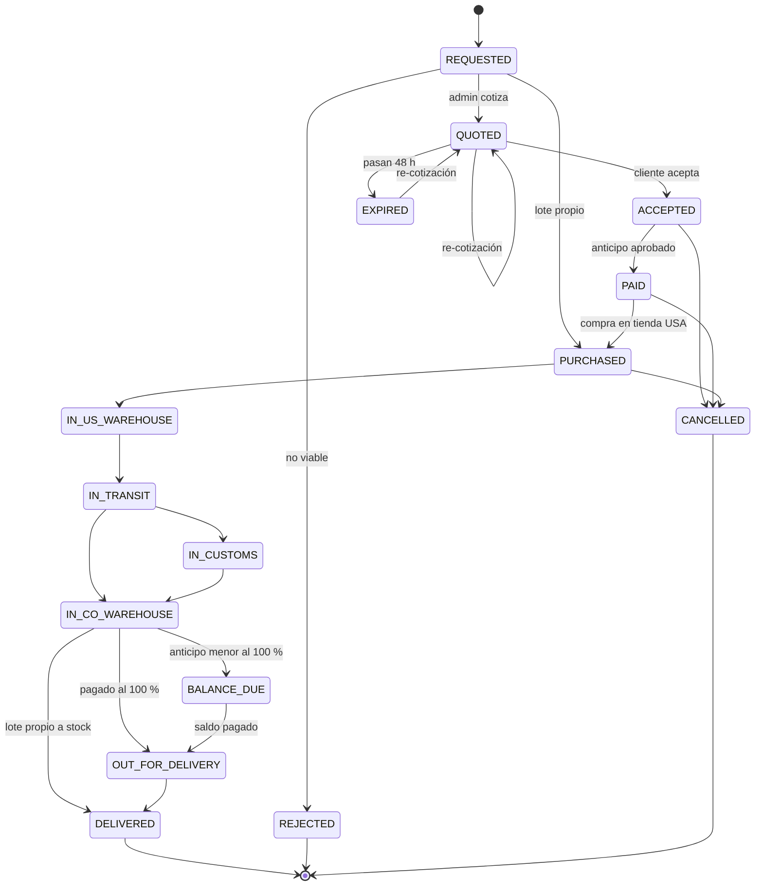

# STARBOY — System Specification Document (SSD)

> **Versión:** 1.2 · **Fecha:** 2026-11-10 · **Estado:** ✅ Especificación cerrada (H1) — fuente única de verdad técnica y de diseño
> **Proyecto:** Plataforma e-commerce de streetwear + Encargos USA con panel de administración auto-sostenible.
> **Mercado:** Colombia (COP) · Envíos nacionales · Importaciones desde USA.

Este documento es la **única fuente de verdad** del proyecto. Cualquier cambio de alcance, esquema o diseño se hace primero aquí (nueva versión + ADR en §14) y después en el código. Para identidad visual, la referencia de origen es el **Manual de marca Starboy**; §12 lo traduce a tokens y componentes.

### Historial de versiones

| Versión | Cambios |
|---------|---------|
| 0.1 | Borrador base: roadmap, arquitectura, ER, flujos, API |
| 0.2 | Go + Gin; Mercado Pago + transferencia + contra entrega; checkout invitado; modelo de encargos |
| 0.3 | Anticipo variable; tarifa fija por categoría; roles Admin/Staff; avisos email + WhatsApp |
| 0.4 | Envíos por zonas; vigencia 48 h; método de tarifas; infraestructura de costo mínimo (Oracle) |
| 0.5 | Desarrollo 100 % local primero; GORM + AutoMigrate; arquitectura de modelos; parámetros editables |
| 1.0 | Especificación cerrada: structs GORM embebidos, sistema de diseño, decisiones por defecto de la Ronda 4 |
| 1.1 | Alineación con el Manual de marca: paleta y tokens semánticos con temas Catálogo/Editorial, Oswald + Barlow, retícula, fotografía, voz y tono, textos de estados, mínimo 4 fotos por producto, plantillas de email/WhatsApp** |
| **1.2** | **§16 Estado de implementación y traspaso: qué está construido (backend y frontend), cómo correrlo, convenciones, trampas conocidas y hoja de ruta de lo pendiente** |

---

## Índice

0. [Estrategia de desarrollo (local-first)](#0-estrategia-de-desarrollo-local-first)
1. [Visión y alcance](#1-visión-y-alcance)
2. [Roadmap por hitos](#2-roadmap-por-hitos)
3. [Actores y roles](#3-actores-y-roles)
4. [Requerimientos funcionales](#4-requerimientos-funcionales)
5. [Requerimientos no funcionales](#5-requerimientos-no-funcionales)
6. [Stack tecnológico e infraestructura](#6-stack-tecnológico-e-infraestructura)
7. [Arquitectura del sistema](#7-arquitectura-del-sistema)
8. [Estructura de carpetas](#8-estructura-de-carpetas)
9. [Modelo de datos (ER + modelos GORM)](#9-modelo-de-datos-er--modelos-gorm)
10. [Flujos y reglas de negocio](#10-flujos-y-reglas-de-negocio)
11. [API REST](#11-api-rest)
12. [Sistema de diseño (Manual de marca → UI)](#12-sistema-de-diseño-manual-de-marca--ui)
13. [Seguridad](#13-seguridad)
14. [Registro de decisiones (ADR)](#14-registro-de-decisiones-adr)
15. [Decisiones por defecto y tareas no bloqueantes](#15-decisiones-por-defecto-y-tareas-no-bloqueantes)
16. [Estado de implementación y traspaso](#16-estado-de-implementación-y-traspaso)

---

## 0. Estrategia de desarrollo (local-first)

**Regla (ADR-020):** nada se despliega en Oracle Cloud hasta que el sistema esté **100 % funcional y probado en local**.

| Fase | Entorno | Qué corre | Salida |
|------|---------|-----------|--------|
| **L1 — Local** | Máquina del desarrollador | PostgreSQL 16 local (Docker o nativo) · API Go (`go run`) · Next.js (`npm run dev`) | Flujos completos funcionando, tests en verde |
| **L2 — Local tipo producción** | Máquina del desarrollador | `docker compose` con las mismas imágenes de producción | Mismo comportamiento que tendrá Oracle |
| **P — Producción** | VM Oracle Cloud (Pay As You Go) | `docker-compose.prod.yml` + Cloudflare | Lanzamiento |

**Cómo se garantiza que el paso a Oracle sea transparente:**
- Misma versión mayor de PostgreSQL (**16**) en local y en producción.
- Mismo esquema, generado por `AutoMigrate` desde los structs de Go (§9.5). No hay SQL distinto por entorno.
- Configuración 100 % por variables de entorno. Entre local y Oracle cambian los valores, nunca el código.
- Seed idempotente (`go run ./cmd/migrate -seed`): admin, categorías, marcas, ajustes y tarifas, sin duplicar.
- Antes del primer deploy: base limpia + seed (o `pg_dump` local → restauración, si se quieren conservar datos de prueba).

**Checklist "listo para Oracle":**
- [ ] `go test ./...` en verde
- [ ] `go run ./cmd/migrate -seed` corre dos veces seguidas sin errores (idempotencia)
- [ ] Flujos E2E en local: compra (Mercado Pago sandbox, transferencia, contra entrega) y encargo completo (solicitud → cotización → anticipo → estados → saldo → entrega)
- [ ] Panel admin: crear producto con 4 fotos y tallas, cambiar precio, editar parámetros de impuestos/flete/comisión
- [ ] Revisión visual contra §12 (temas, tipografías, contraste, foco de teclado)
- [ ] Stack completo con `docker compose` local (fase L2)
- [ ] Backup y restauración probados

---

## 1. Visión y alcance

**Starboy Streetwear** — *"The culture never stops."* Tienda online de sneakers, ropa y accesorios streetwear originales en Colombia, con servicio de **Encargos USA**.

**Promesa de marca:** lo mejor del streetwear, 100 % original, traído hasta tu puerta en cualquier parte de Colombia. **Diferencial:** Encargos USA ("Traemos cualquier referencia") es parte de la identidad, no un servicio escondido.

La plataforma permite:
- Comprar **stock importado disponible** (ya en Colombia, venta directa).
- **Solicitar cualquier referencia** de EE. UU. mediante cotización por enlace del producto.
- **Rastrear** el encargo por estados.

El negocio se opera **100 % desde el panel de administración** (productos, fotos, precios, tallas, inventario, cotizaciones, estados y parámetros de negocio) sin tocar código.

### Fuera de alcance (v1)
- App móvil nativa (la web es responsive; PWA opcional).
- Marketplace multi-vendedor.
- Casillero con dirección USA propia para cada cliente.
- Integración automática con APIs de couriers y transportadoras (v1 = estados y guías manuales).

---

## 2. Roadmap por hitos

| # | Hito | Entregables | Criterio de salida |
|---|------|-------------|--------------------|
| **H1** ✅ | Especificación | Este SSD | Cerrado |
| **H2** | Modelos y BD (local) | Structs GORM, AutoMigrate, seed, PostgreSQL local, `/health` | `go run ./cmd/migrate -seed` + `GET /health` → `"database":"up"` |
| **H3** | Backend API (local) | Auth/JWT, catálogo, inventario, carrito, órdenes, encargos/cotizaciones, uploads, pagos, tests | Endpoints probados, ≥ 70 % de cobertura en servicios |
| **H4** | Frontend tienda (local) | Tokens y componentes de §12, Home, catálogo, producto, carrito, checkout, cuenta, Encargos USA | Flujos de compra y de encargo E2E en verde; revisión visual contra §12 |
| **H5** | Panel Admin (local) | Productos + fotos, inventario, órdenes, Kanban de encargos, ajustes | Un no-técnico crea un producto con 4 fotos y tallas en < 3 min |
| **H6** | Validación local tipo producción | `docker compose` completo, backups, checklist §0 | Checklist "listo para Oracle" completo |
| **H7** | Despliegue Oracle | VM Pay As You Go, Cloudflare, dominio, monitoreo | Producción estable 7 días |
| **H8** | Post-lanzamiento (v2) | WhatsApp automático, API de envíos, cupones avanzados, fidelidad | Según métricas |



---

## 3. Actores y roles

| Rol | Descripción | Permisos clave |
|-----|-------------|----------------|
| **Visitante** | Navega sin cuenta | Catálogo, carrito, calculadora de encargos, compra como invitado |
| **Cliente** (`CUSTOMER`) | Usuario registrado | Comprar, solicitar encargos, historial, rastreo, direcciones, favoritos |
| **Admin** (`ADMIN`) | Socios fundadores (2 cuentas) | Todo, incluidos precios, ajustes, tarifas y usuarios |
| **Staff** (`STAFF`) | Empleados futuros (rol listo desde v1) | Órdenes, inventario y estados de encargos; sin precios, ajustes, tarifas ni finanzas |

Toda acción administrativa queda en `audit_log` (quién, qué, cuándo).

---

## 4. Requerimientos funcionales

> Todos los textos de interfaz siguen la voz y el tono de §12.1 (español de Colombia, tuteo, botones que empiezan por verbo).

### 4.1 Tienda (frontend público)
- **RF-01 Top bar** configurable desde el admin (*ENVÍOS GRATIS DESDE $300.000 · PAGO CONTRA ENTREGA · IMPORTAMOS DESDE USA*).
- **RF-02 Navegación**: INICIO · HOMBRE ▾ · MUJER ▾ · ENCARGOS USA ▾ · PROMOCIONES · CONTACTO · búsqueda · cuenta · bolsa.
  - Mega-menú Hombre/Mujer: Zapatos, Ropa, Accesorios, Marcas, Nuevos lanzamientos.
  - Mega-menú Encargos USA: Stock disponible, Traemos cualquier referencia, ¿Cómo funciona?, Tiempo de entrega, Solicitar cotización.
- **RF-03 Home**: hero administrable (NEW SEASON), tarjetas de categoría (HOMBRE, MUJER, ENCARGOS USA), carrusel de Promociones, grilla de Nuevos lanzamientos, bloque de confianza (los 4 pilares de §12.1), Instagram, footer.
- **RF-04 Catálogo**: filtros por categoría, talla, marca y rango de precio; orden (más recientes, precio ↑↓, descuento); paginación; breadcrumbs.
- **RF-05 Producto**: galería de **mínimo 4 fotos** (lateral, superior, trasera, suela o detalle), colorway, precio/tachado, selector de talla con disponibilidad, favoritos, guía de tallas, relacionados.
- **RF-06 Carrito**: drawer lateral, cantidades, cupón, barra de progreso hacia envío gratis.
- **RF-07 Checkout**: compra como invitado (nombre, email, teléfono, cédula opcional); dirección; Mercado Pago / transferencia con comprobante / contra entrega; confirmación por email. El invitado consulta su pedido con `código + email`.
- **RF-08 Cuenta**: perfil, direcciones, pedidos, encargos con línea de tiempo, favoritos.

### 4.2 Encargos USA
- **RF-10 Stock disponible**: productos con `origin = IMPORTED_STOCK`.
- **RF-11 Calculadora pública**: precio USD + categoría → total estimado en COP + anticipo sugerido, con los parámetros vigentes en `settings` (§10.4).
- **RF-12 Solicitud de encargo** (requiere cuenta): URL, tienda, talla/color, cantidad, notas, captura. Botón: SOLICITAR COTIZACIÓN.
- **RF-13 Bandeja de cotizaciones (admin)**: revisar, ajustar, emitir (versionada), rechazar.
- **RF-14 Aceptación y pago**: anticipo variable por cotización (por defecto 50 %); saldo al llegar a Colombia, antes del despacho.
- **RF-15 Rastreo por estados** con historial fechado (§10.3).
- **RF-16 Convertir a stock**: unidades importadas → producto en venta.
- **RF-17 Lotes propios** (`STORE_RESTOCK`): importaciones de Starboy sin cliente, con costo real para calcular margen.
- **RF-18 Vencimiento automático**: una cotización no aceptada vence a las **48 h** (editable).

### 4.3 Panel de administración
- **RF-20 Dashboard**: ventas, órdenes pendientes, cotizaciones nuevas, stock bajo, transferencias por validar.
- **RF-21 Productos**: CRUD, drag & drop de fotos, variantes por talla con SKU y stock, marcas, categorías, etiquetas, publicar/ocultar. **Regla de marca:** un producto solo pasa a `ACTIVE` con **al menos 4 fotos**; el admin muestra cuántas faltan (validación en el servicio, no en la BD).
- **RF-22 Inventario**: tabla editable, historial de movimientos, alertas.
- **RF-23 Órdenes**: filtros, detalle, estados, notas, transportadora + guía.
- **RF-24 Encargos**: Kanban por estado, cotizaciones, cambio de estado con aviso al cliente.
- **RF-25 Promociones y cupones**.
- **RF-26 Contenido**: banners, top bar, textos, FAQ, fotos de Instagram.
- **RF-27 Ajustes de negocio** (sin código): TRM Starboy, umbral de exención (USD), % arancel, % IVA, % comisión y mínima, % anticipo por defecto, vigencia de cotizaciones (horas), umbral de envío gratis (§9.4).
- **RF-28 Clientes**: listado, detalle, historial.
- **RF-29 Notificaciones**: email automático con la plantilla de marca (§12.11) + botón "Avisar por WhatsApp" (`wa.me` con mensaje prellenado según estado, en la voz de §12.1).
- **RF-30 Envíos nacionales**: zonas con tarifa fija y tiempos; transportadora + guía por orden.
- **RF-31 Tarifas de encargo por categoría**: desglose (flete, manejo, seguro, despacho, margen); el total se recalcula solo.

---

## 5. Requerimientos no funcionales

| ID | Requisito | Meta |
|----|-----------|------|
| RNF-01 | Performance | LCP < 2.5 s en 4G; imágenes AVIF/WebP vía CDN; fuentes con `next/font` (`display: swap`) |
| RNF-02 | Responsive | Mobile-first (el prototipo móvil es referencia primaria) |
| RNF-03 | SEO | SSR/ISR en catálogo y producto, sitemap, datos estructurados `Product` |
| RNF-04 | Disponibilidad | 99.5 % mensual |
| RNF-05 | Seguridad | OWASP Top 10 (§13) |
| RNF-06 | Concurrencia de stock | Reserva atómica sin sobreventa (transacción + CHECK) |
| RNF-07 | Observabilidad | Logs JSON (`slog`), request-id, alertas |
| RNF-08 | Accesibilidad | WCAG 2.1 AA; foco visible en ambos temas; estados con texto o ícono, nunca solo color (§12.3) |
| RNF-09 | Localización | es-CO, COP sin decimales con punto de miles, `America/Bogota` |
| RNF-10 | Portabilidad | Mismo binario y esquema en local y en Oracle; solo cambian variables de entorno |
| RNF-11 | Consistencia de marca | Los componentes usan solo tokens de §12.12; prohibidos colores o fuentes sueltos en el código |

---

## 6. Stack tecnológico e infraestructura

| Capa | Decisión | ADR |
|------|----------|-----|
| Frontend | Next.js (App Router) + TypeScript + TailwindCSS v4 + shadcn/ui (re-tematizado con tokens §12) | ADR-001 |
| Tipografías | **Oswald** (display) + **Barlow** (texto), Google Fonts vía `next/font` | ADR-023 |
| Íconos | `lucide-react` (trazo 1.5 px) + íconos de redes | ADR-021 |
| Panel admin | Misma app Next.js bajo `/admin`, tema Catálogo | — |
| Estado cliente | Zustand (carrito) + TanStack Query | — |
| Formularios | React Hook Form + Zod | — |
| Backend | Go + Gin | ADR-005 |
| ORM y esquema | GORM (`gorm.io/gorm` + `gorm.io/driver/postgres`, basado en pgx) con `AutoMigrate` + SQL idempotente pre/post | ADR-019 |
| Base de datos | PostgreSQL 16: local en desarrollo, en Docker dentro de la VM Oracle en producción | ADR-014 |
| Imágenes | Cloudinary (plan gratuito) | ADR-006 |
| Auth | JWT propio (access 15 min + refresh rotativo en cookie httpOnly); contraseñas bcrypt costo 12 | — |
| Pagos | Mercado Pago (Checkout Pro + webhooks) · transferencia manual · contra entrega | ADR-007 |
| Notificaciones | Email transaccional (Resend o Brevo, gratis) con plantilla de marca + enlaces WhatsApp | ADR-012 |
| Configuración | Variables de entorno; `.env` solo en local (`godotenv`) | — |
| Deploy | VM Oracle (Ampere A1, ARM64) + Docker Compose (Caddy, Next.js, API, PostgreSQL) + Cloudflare | ADR-015 |
| CI/CD | GitHub Actions: lint, test, build ARM64, deploy por SSH | — |
| Monitoreo | UptimeRobot / Better Stack + Sentry (gratis) | — |

### 6.1 Entorno local (fase L1)

| Componente | Cómo corre | Puerto |
|------------|-----------|--------|
| PostgreSQL 16 | `docker compose up -d postgres` (recomendado) o instalación nativa | 5432 |
| Migración + seed | `go run ./cmd/migrate -seed` | — |
| API Go | `go run ./cmd/server` (carga `.env`) | 8080 |
| Frontend | `npm run dev` | 3000 |

`apps/api/.env.example`:

```env
APP_ENV=development
HTTP_PORT=8080

DB_HOST=localhost
DB_PORT=5432
DB_USER=starboy
DB_PASSWORD=cambia-esto
DB_NAME=starboy
DB_SSLMODE=disable
DB_TIMEZONE=America/Bogota
DB_AUTO_MIGRATE=true
DB_LOG_SQL=true

SEED_ADMIN_EMAIL=admin@starboy.local
SEED_ADMIN_PASSWORD=una-clave-larga-segura
SEED_ADMIN_NAME=Administrador Starboy
```

### 6.2 Producción de costo mínimo (ADR-015)

```
                    Cloudflare (gratis: DNS, CDN, SSL, anti-DDoS)
                                         │
                ┌────────────────────────┴────────────────────────┐
                │      VM Oracle Cloud — Ampere A1 (ARM64)         │
                │  docker compose:                                 │
                │   ├─ caddy        :443  HTTPS + reverse proxy    │
                │   ├─ web          Next.js (standalone)           │
                │   ├─ api          Go + Gin                       │
                │   ├─ postgres     PostgreSQL 16 (volumen)        │
                │   └─ backup       pg_dump diario → Object Storage│
                └──────────────────────────────────────────────────┘
   Cloudinary (imágenes)   ·   Resend/Brevo (email)   ·   Mercado Pago (pagos)
```

| Servicio | Plan | Costo mensual |
|----------|------|---------------|
| Oracle Cloud VM A1 + disco + Object Storage | Always Free (cuenta Pay As You Go) | $0 dentro de los límites |
| Cloudflare | Free | $0 |
| Cloudinary | Free (25 créditos) | $0 |
| Email transaccional | Free | $0 |
| GitHub (repo + Actions + registry) | Free | $0 |
| UptimeRobot / Sentry | Free | $0 |
| Google Fonts (Oswald, Barlow) | Gratis (licencia OFL), servidas desde el propio sitio con `next/font` | $0 |
| Dominio | Anual | ≈ USD 1–3/mes prorrateado |
| Mercado Pago | Por transacción | Solo comisión por venta aprobada |

**Riesgos y decisiones:**
- El plan Hobby de Vercel no permite uso comercial → Next.js corre en la VM.
- La BD gratis de Oracle es Autonomous Database (motor Oracle) → se usa PostgreSQL en Docker.
- En 2026 Oracle redujo el Always Free de Ampere A1 a 2 OCPU / 12 GB en cuentas solo gratuitas; alcanza para este stack. Se usa cuenta Pay As You Go + alerta de presupuesto de USD 1.
- Punto único de falla → backups diarios fuera de la VM y restauración probada.

---

## 7. Arquitectura del sistema



**Principios:**
- Capas `handler` (HTTP, validación, DTOs) → `service` (reglas de negocio, transacciones) → `repository` (GORM). Los handlers nunca usan `*gorm.DB` directamente.
- Los structs de `internal/models` son la **fuente de verdad del esquema** (§9.5).
- Los tokens de `apps/web/src/styles/tokens.css` son la **fuente de verdad visual** (§12.12).
- Dinero en enteros (`int64` → `bigint`): COP sin decimales, USD en centavos. Nunca `float64` para dinero.
- Mutaciones de stock en transacción con bloqueo de fila (`clause.Locking{Strength: "UPDATE"}`) y CHECK en la BD como última defensa.
- Errores de PostgreSQL traducidos por GORM (`TranslateError: true` → `gorm.ErrDuplicatedKey`, etc.) y devueltos con formato uniforme `{ "error": { "code", "message", "details" } }`.

---

## 8. Estructura de carpetas

```
starboy/
├── SSD.md                        # este documento
├── apps/
│   ├── web/                      # Next.js (tienda + admin)
│   └── api/                      # Go + Gin + GORM
├── infra/
│   ├── docker-compose.yml        # local: PostgreSQL 16 (luego el stack completo)
│   ├── docker-compose.prod.yml   # Oracle: caddy, web, api, postgres, backup
│   ├── Caddyfile
│   └── scripts/{backup.sh,restore.sh,deploy.sh}
├── docs/
│   ├── adr/
│   └── brand/                    # Manual de marca (copia de referencia)
├── .github/workflows/
└── Makefile
```

### 8.1 Backend — Go + Gin + GORM

```
apps/api/
├── cmd/
│   ├── server/main.go            # arranca la API (AutoMigrate si DB_AUTO_MIGRATE=true)
│   └── migrate/main.go           # AutoMigrate explícito; -seed carga datos iniciales
├── internal/
│   ├── config/config.go          # variables de entorno + validación
│   ├── models/                   # ⭐ structs GORM = esquema de la BD (§9.5)
│   │   ├── base.go
│   │   ├── types.go
│   │   ├── user.go
│   │   ├── catalog.go
│   │   ├── imports.go
│   │   ├── settings.go
│   │   ├── orders.go             # H3: Order, OrderItem, Payment, ShippingZone, Cart…
│   │   └── models_test.go
│   ├── platform/
│   │   ├── database/
│   │   │   ├── postgres.go       # gorm.Open, pool, ping
│   │   │   └── migrate.go        # preMigrate → AutoMigrate(Models()...) → postMigrate
│   │   ├── storage/              # Cloudinary (firma de uploads)
│   │   ├── payments/             # PaymentProvider: mercadopago, manualtransfer
│   │   └── mailer/               # plantillas de email con la marca (§12.11)
│   ├── seed/seed.go              # datos iniciales idempotentes
│   ├── http/
│   │   ├── router.go             # Gin, /health, /api/v1
│   │   ├── middleware/           # auth, rbac, cors, ratelimit, requestid
│   │   └── response/             # formato de éxito/error
│   └── domain/                   # un paquete por módulo
│       ├── auth/        {handler.go, service.go, repository.go, dto.go}
│       ├── catalog/     # incluye la regla "ACTIVE requiere ≥ 4 fotos"
│       ├── inventory/
│       ├── cart/
│       ├── order/
│       ├── payment/
│       ├── importreq/   # cotizador, transiciones de estado, vencimiento 48 h
│       ├── settings/
│       └── user/
├── .env.example
├── go.mod
└── Dockerfile
```

> **¿Por qué `models` es un paquete central?** `AutoMigrate` necesita conocer todos los modelos y sus relaciones (User ↔ ImportRequest ↔ Product). Un único paquete evita ciclos de importación entre dominios: los paquetes de `domain/` usan los modelos, pero no los definen.

### 8.2 Frontend — Next.js (App Router)

```
apps/web/
├── public/
│   └── assets/
│       ├── Logos/
│       │   └── starboy-logo-sobre-oscuro.png   # versión principal (pendiente SVG, §15)
│       └── reference/                          # referencias del manual (§12.6)
│           ├── hero-new-season.jpg
│           ├── tarjetas-categoria.jpg
│           ├── megamenu.jpg
│           └── producto-sobre-blanco.jpg
├── src/
│   ├── app/
│   │   ├── layout.tsx                       # carga Oswald + Barlow (next/font) y tokens
│   │   ├── (shop)/
│   │   │   ├── layout.tsx                   # TopBar + Navbar + Footer (tema Editorial en header/footer)
│   │   │   ├── page.tsx                     # Home
│   │   │   ├── [gender]/[[...category]]/page.tsx  # /hombre/zapatos
│   │   │   ├── promociones/page.tsx
│   │   │   ├── nuevos/page.tsx
│   │   │   ├── producto/[slug]/page.tsx
│   │   │   ├── carrito/page.tsx
│   │   │   ├── checkout/…
│   │   │   ├── encargos-usa/
│   │   │   │   ├── page.tsx                 # ¿Cómo funciona? + tiempos
│   │   │   │   ├── stock/page.tsx           # Stock disponible
│   │   │   │   ├── cotizar/page.tsx         # Calculadora + formulario
│   │   │   │   └── rastreo/[code]/page.tsx
│   │   │   ├── cuenta/{pedidos,encargos,direcciones,favoritos}/…
│   │   │   └── contacto/page.tsx
│   │   ├── (auth)/{login,registro,recuperar}/page.tsx
│   │   └── admin/                           # tema Catálogo
│   │       ├── layout.tsx                   # Sidebar, guard de rol
│   │       ├── page.tsx                     # Dashboard
│   │       ├── productos/ inventario/ ordenes/ encargos/ pagos/
│   │       └── promociones/ contenido/ clientes/ ajustes/ tarifas/
│   ├── components/
│   │   ├── bundle.css                       # clases sb-* de componentes (solo tokens)
│   │   ├── ui/                              # primitivas shadcn re-tematizadas
│   │   ├── layout/ {TopBar, Navbar, MegaMenu, MobileNav, Footer}
│   │   ├── home/ {HeroBanner, CategoryCard, SectionHeader, TrustBadges, InstagramGrid}
│   │   ├── product/ {ProductCard, ProductGallery, SizeSelector, Price, Badge, Filters}
│   │   ├── cart/ {CartDrawer, FreeShippingBar}
│   │   ├── imports/ {CostEstimator, QuoteForm, QuoteBreakdown, TrackingTimeline, StatusBadge}
│   │   └── admin/ {DataTable, ImageUploader, VariantMatrix, KanbanBoard, SettingField}
│   ├── lib/ {api-client.ts, auth.ts, format.ts, fonts.ts, validators/}
│   ├── stores/cart.ts
│   └── styles/
│       ├── tokens.css                       # §12.12: paleta, tokens semánticos, temas, escala
│       └── globals.css                      # @import tailwind + tokens + bundle
├── middleware.ts                            # protege /admin y /cuenta
└── next.config.ts
```

---

## 9. Modelo de datos (ER + modelos GORM)

### 9.1 Diagrama entidad-relación

```mermaid
erDiagram
    USERS ||--o{ ADDRESSES : tiene
    USERS ||--o{ ORDERS : realiza
    USERS ||--o{ IMPORT_REQUESTS : solicita
    USERS ||--o| CARTS : posee
    USERS ||--o{ WISHLIST_ITEMS : guarda

    BRANDS ||--o{ PRODUCTS : agrupa
    CATEGORIES ||--o{ PRODUCTS : clasifica
    CATEGORIES ||--o{ CATEGORIES : "padre de"
    PRODUCTS ||--o{ PRODUCT_IMAGES : muestra
    PRODUCTS ||--|{ PRODUCT_VARIANTS : "se vende en"
    PRODUCTS ||--o{ WISHLIST_ITEMS : ""
    PRODUCT_VARIANTS ||--o{ INVENTORY_MOVEMENTS : registra
    PRODUCT_VARIANTS ||--o{ CART_ITEMS : ""
    PRODUCT_VARIANTS ||--o{ ORDER_ITEMS : ""

    PROMOTIONS ||--o{ PROMOTION_TARGETS : aplica
    COUPONS ||--o{ ORDERS : "se usa en"
    CARTS ||--o{ CART_ITEMS : contiene
    ORDERS ||--|{ ORDER_ITEMS : contiene
    ORDERS ||--o{ PAYMENTS : "se paga con"
    ORDERS ||--o{ ORDER_STATUS_HISTORY : traza
    SHIPPING_ZONES ||--o{ SHIPPING_ZONE_CITIES : incluye
    SHIPPING_ZONES ||--o{ ORDERS : "tarifa de envío"

    IMPORT_REQUESTS ||--|{ IMPORT_REQUEST_ITEMS : contiene
    IMPORT_REQUESTS ||--o{ IMPORT_QUOTES : recibe
    IMPORT_REQUESTS ||--o{ IMPORT_STATUS_HISTORY : traza
    IMPORT_REQUESTS ||--o{ PAYMENTS : "se paga con"
    IMPORT_RATES ||--o{ IMPORT_REQUEST_ITEMS : "tarifa aplicada"
    IMPORT_REQUEST_ITEMS ||--o| PRODUCTS : "se convierte en stock"

    USERS {
        uuid id PK
        varchar email UK
        varchar password_hash
        varchar full_name
        varchar phone
        varchar document_id "cédula (aduanas)"
        varchar role "CUSTOMER|STAFF|ADMIN"
        bool is_active
        timestamptz last_login_at
    }
    ADDRESSES {
        uuid id PK
        uuid user_id FK
        varchar label
        varchar department
        varchar city
        varchar dane_code
        varchar line1
        varchar line2
        bool is_default "único por usuario"
    }
    BRANDS {
        uuid id PK
        varchar name UK
        varchar slug UK
        text logo_url
        bool is_active
    }
    CATEGORIES {
        uuid id PK
        uuid parent_id FK
        varchar name
        varchar slug UK
        int sort_order
        bool is_active
    }
    PRODUCTS {
        uuid id PK
        uuid brand_id FK
        uuid category_id FK
        varchar name
        varchar slug UK
        varchar colorway
        text description
        varchar gender "MEN|WOMEN|UNISEX"
        varchar origin "LOCAL|IMPORTED_STOCK"
        varchar status "DRAFT|ACTIVE|ARCHIVED"
        bigint base_price_cop
        bigint compare_at_price_cop
        bigint cost_cop "interno"
        bool is_new_release
        bool is_featured
        timestamptz published_at
    }
    PRODUCT_IMAGES {
        uuid id PK
        uuid product_id FK
        varchar public_id "Cloudinary"
        text url
        varchar alt
        int position "0 = principal"
    }
    PRODUCT_VARIANTS {
        uuid id PK
        uuid product_id FK "único con size"
        varchar sku UK
        varchar size
        varchar size_system "EU|US|ALPHA|ONE"
        bigint price_override_cop
        int stock_on_hand "CHECK >= 0"
        int stock_reserved "CHECK 0..on_hand"
        int version
    }
    INVENTORY_MOVEMENTS {
        uuid id PK
        uuid variant_id FK
        int delta
        varchar reason "PURCHASE|SALE|RETURN|ADJUST|IMPORT_IN"
        uuid ref_id
        uuid created_by FK
    }
    PROMOTIONS {
        uuid id PK
        varchar type "PERCENT|FIXED"
        int value
        timestamptz starts_at
        timestamptz ends_at
    }
    PROMOTION_TARGETS {
        uuid promotion_id FK
        varchar target_type "PRODUCT|CATEGORY|BRAND"
        uuid target_id
    }
    COUPONS {
        uuid id PK
        varchar code UK
        varchar type "PERCENT|FIXED|FREE_SHIPPING"
        int value
        bigint min_subtotal_cop
        int max_uses
        int used_count
    }
    CARTS {
        uuid id PK
        uuid user_id FK "null = invitado"
        varchar session_token
    }
    CART_ITEMS {
        uuid cart_id FK
        uuid variant_id FK
        int quantity
    }
    ORDERS {
        uuid id PK
        varchar code UK "SB-000123"
        uuid user_id FK "null = invitado"
        varchar customer_name
        varchar customer_email
        varchar customer_phone
        varchar status
        varchar payment_method "MERCADOPAGO|BANK_TRANSFER|CASH_ON_DELIVERY"
        bigint subtotal_cop
        bigint discount_cop
        bigint shipping_cop
        bigint total_cop
        jsonb shipping_address "snapshot"
        uuid shipping_zone_id FK
        varchar carrier
        varchar tracking_number
    }
    ORDER_ITEMS {
        uuid id PK
        uuid order_id FK
        uuid variant_id FK
        varchar product_name "snapshot"
        varchar size "snapshot"
        int quantity
        bigint unit_price_cop
    }
    ORDER_STATUS_HISTORY {
        uuid id PK
        uuid order_id FK
        varchar status
        text note
        uuid changed_by FK
    }
    PAYMENTS {
        uuid id PK
        uuid order_id FK "nullable"
        uuid import_request_id FK "nullable"
        varchar provider
        varchar provider_ref UK
        varchar kind "FULL|DEPOSIT|BALANCE"
        bigint amount_cop
        varchar status "PENDING|IN_REVIEW|APPROVED|DECLINED|REFUNDED"
        text receipt_url
        uuid reviewed_by FK
        jsonb raw_payload
    }
    SHIPPING_ZONES {
        uuid id PK
        varchar name
        bigint fee_cop
        int eta_days_min
        int eta_days_max
        bool cod_allowed
    }
    SHIPPING_ZONE_CITIES {
        uuid zone_id FK
        varchar dane_code
        varchar city
        varchar department
    }
    IMPORT_REQUESTS {
        uuid id PK
        varchar code UK "IMP-000045"
        uuid user_id FK "null = lote propio"
        varchar type "CUSTOMER_ORDER|STORE_RESTOCK"
        varchar status "ver 10.3"
        text customer_notes
        text internal_notes
        varchar carrier_usa
        varchar tracking_usa
        varchar tracking_co
        numeric weight_lb
        timestamptz eta
    }
    IMPORT_REQUEST_ITEMS {
        uuid id PK
        uuid import_request_id FK
        text product_url
        varchar store_name
        varchar description
        varchar size
        varchar color
        int quantity "CHECK > 0"
        bigint declared_price_usd_cents
        text screenshot_url
        uuid import_rate_id FK
        uuid converted_product_id FK
    }
    IMPORT_RATES {
        uuid id PK
        varchar name UK
        numeric avg_weight_lb
        bigint freight_cop
        bigint handling_cop
        bigint insurance_cop
        bigint national_delivery_cop
        bigint margin_cop
        bigint flat_fee_cop "suma automática"
        bigint max_declared_usd_cents
        bool requires_manual_quote
        bool is_active
    }
    IMPORT_QUOTES {
        uuid id PK
        uuid import_request_id FK "único con version"
        int version
        bigint product_cost_usd_cents
        bigint us_shipping_usd_cents
        bigint exchange_rate_cop "TRM entera"
        bigint product_cop
        bigint logistics_cop
        bigint service_fee_cop
        bigint taxes_cop
        bigint total_cop
        int deposit_percent "CHECK 0..100"
        bigint deposit_cop
        bigint balance_cop
        bool balance_cod_allowed
        bool taxes_applied
        jsonb params_used "snapshot de settings"
        timestamptz valid_until "creación + 48 h"
        varchar status "SENT|ACCEPTED|REJECTED|EXPIRED"
        uuid created_by_id FK
    }
    IMPORT_STATUS_HISTORY {
        uuid id PK
        uuid import_request_id FK
        varchar status
        text note
        bool notify_customer
        uuid changed_by_id FK
    }
    WISHLIST_ITEMS {
        uuid user_id FK
        uuid product_id FK
    }
    SETTINGS {
        varchar key PK
        jsonb value
        varchar description
    }
    BANNERS {
        uuid id PK
        varchar placement "HERO|TOPBAR|CATEGORY_CARD|INSTAGRAM"
        varchar title
        text image_url
        varchar cta_url
        int position
        bool active
    }
    AUDIT_LOG {
        uuid id PK
        uuid actor_id FK
        varchar action
        varchar entity
        uuid entity_id
        jsonb diff
    }
```



> Todas las tablas con `Base` incluyen además `created_at` y `updated_at`. Las entidades de órdenes, pagos, carrito, envíos, marketing y auditoría se modelan en H3 siguiendo las mismas convenciones.

### 9.2 Gestión del esquema con AutoMigrate (ADR-019)

**Fuente de verdad:** los structs de `internal/models` (§9.5). El esquema se aplica en tres pasos, dentro de una transacción:

```
preMigrate   → extensiones y secuencias
AutoMigrate  → tablas, columnas, FKs, índices y CHECK definidos en los tags gorm:"..."
postMigrate  → lo que los tags no expresan: índices parciales, GIN, índices ordenados
```

SQL de `preMigrate` y `postMigrate` (todo idempotente, se puede correr en cada arranque):

```sql
-- preMigrate
CREATE EXTENSION IF NOT EXISTS pg_trgm;                          -- búsqueda por nombre
CREATE SEQUENCE IF NOT EXISTS import_request_code_seq START 1;   -- IMP-000001…

-- postMigrate
CREATE UNIQUE INDEX IF NOT EXISTS uq_quote_one_accepted
  ON import_quotes (import_request_id) WHERE status = 'ACCEPTED';  -- una sola cotización aceptada
CREATE UNIQUE INDEX IF NOT EXISTS uq_address_one_default
  ON addresses (user_id) WHERE is_default;                         -- una sola dirección por defecto
CREATE INDEX IF NOT EXISTS idx_products_name_trgm
  ON products USING gin (name gin_trgm_ops);                       -- búsqueda "jordan 4"
CREATE INDEX IF NOT EXISTS idx_import_requests_user_created
  ON import_requests (user_id, created_at DESC);                   -- historial del cliente
```

Orden de `AutoMigrate(Models()...)`: `User`, `Address`, `Brand`, `Category`, `Product`, `ProductImage`, `ProductVariant`, `ImportRate`, `ImportRequest`, `ImportRequestItem`, `ImportQuote`, `ImportStatusHistory`, `Setting`.

**Convenciones de modelos:**

| Regla | Ejemplo |
|-------|---------|
| ID UUID generado por PostgreSQL (≥ 13) | `gorm:"type:uuid;primaryKey;default:gen_random_uuid()"` |
| Dinero en `int64` con sufijo de moneda | `BasePriceCOP`, `DeclaredPriceUSDCents` |
| Enums = tipo `string` en Go + `CHECK` con nombre | `check:chk_users_role,role IN ('CUSTOMER','STAFF','ADMIN')` |
| Tipos y longitudes explícitos | `type:varchar(160);not null` |
| FKs con política explícita | `RESTRICT` (catálogo), `CASCADE` (hijos), `SET NULL` (referencias opcionales) |
| Campos internos ocultos en JSON | `PasswordHash`, `CostCOP`, `InternalNotes` → `json:"-"` |
| Integridad simple en hooks | `ImportRate.BeforeSave` (total), `ImportQuote.BeforeCreate` (48 h), `ImportRequest.BeforeCreate` (código) |
| Reglas puras en métodos | `CanTransition()`, `DiscountPercent()`, `Available()` |
| Reglas de negocio con contexto en servicios | "ACTIVE requiere ≥ 4 fotos" vive en `domain/catalog`, no en hooks |
| Sin `gorm.DeletedAt` en v1 | Se archiva con `status`/`is_active`; evita conflictos con índices únicos |

**Limitaciones de AutoMigrate y cómo se manejan:**

| AutoMigrate… | Solución |
|---|---|
| Nunca **borra** columnas ni tablas | `ALTER TABLE … DROP COLUMN` explícito en `postMigrate` |
| No detecta **renombres** (crea columna nueva) | `ALTER TABLE … RENAME COLUMN` en `preMigrate`, **antes** de cambiar el struct |
| Cambios de tipo riesgosos | Columna nueva + copia de datos + borrado manual |
| No crea índices parciales ni GIN | `postMigrate` |
| No guarda historial de versiones | Cada cambio de esquema en un commit con prefijo `schema:` y nota en este SSD |

**Regla de producción:** `pg_dump` automático antes de cada deploy; luego `go run ./cmd/migrate` (o `DB_AUTO_MIGRATE=true`). Si el esquema crece mucho, se puede pasar a migraciones versionadas (golang-migrate o Atlas) generadas desde los mismos structs, sin reescribirlos.

### 9.3 Mapeo entidad → struct

| Tabla | Struct | Archivo | Hito |
|-------|--------|---------|------|
| users, addresses | `User`, `Address` | `user.go` | H2 |
| brands, categories, products, product_images, product_variants | `Brand`, `Category`, `Product`, `ProductImage`, `ProductVariant` | `catalog.go` | H2 |
| import_requests, import_request_items, import_quotes, import_status_history, import_rates | `ImportRequest`, `ImportRequestItem`, `ImportQuote`, `ImportStatusHistory`, `ImportRate` | `imports.go` | H2 |
| settings | `Setting` | `settings.go` | H2 |
| orders, order_items, payments, carts, cart_items, shipping_zones, shipping_zone_cities | — | `orders.go` | H3 |
| coupons, promotions, promotion_targets, banners, wishlist_items | — | `marketing.go` | H3 |
| inventory_movements, audit_log | — | `audit.go` | H3 |

### 9.4 Parámetros de negocio (`settings`, editables desde el admin)

| Clave | Valor inicial | Uso |
|-------|---------------|-----|
| `exchange_rate_cop` | 4200 | TRM Starboy (pesos por USD, entero) |
| `tax_exempt_threshold_usd` | 200 | Umbral sin impuestos (**cambiar a 50 si aduanas lo confirma**) |
| `tariff_percent` | 10 | Arancel si se supera el umbral |
| `vat_percent` | 19 | IVA si se supera el umbral |
| `service_fee_percent` | 12 | Comisión de servicio |
| `service_fee_min_cop` | 35000 | Comisión mínima |
| `default_deposit_percent` | 50 | Anticipo por defecto |
| `quote_validity_hours` | 48 | Vigencia de cotizaciones |
| `free_shipping_threshold_cop` | 300000 | Envío nacional gratis |

Cada cotización guarda una **foto de los parámetros usados** (`import_quotes.params_used`): si el admin cambia la TRM o el umbral, las cotizaciones ya emitidas no cambian.

**Seed inicial (idempotente):**
- Admin desde `SEED_ADMIN_*`.
- Categorías: Zapatos (Sneakers, Botas, Sandalias), Ropa (Camisetas, Hoodies, Pantalones, Chaquetas), Accesorios (Gorras, Medias, Bolsos).
- Marcas: Nike, Jordan, Adidas, New Balance, Essentials.
- Ajustes de la tabla anterior.
- Tarifas de encargo de §10.8, con costos en 0 hasta tener la tarifa del courier.

### 9.5 Modelos GORM (`apps/api/internal/models/`)

> **Estado:** especificados; pendientes de la primera compilación y de `AutoMigrate` contra PostgreSQL 16 local (criterio de salida de H2). Dependencias: `gorm.io/gorm`, `gorm.io/driver/postgres`, `github.com/google/uuid`.

#### `base.go`

```go
// Package models contiene las entidades del dominio mapeadas con GORM.
//
// Convenciones:
//   - IDs UUID generados por PostgreSQL (gen_random_uuid(), nativo desde PG 13).
//   - Dinero SIEMPRE en int64: pesos COP sin decimales (*COP) o centavos de dólar (*USDCents).
//   - Enumeraciones como string + restricción CHECK con nombre en la BD.
//   - El esquema se crea/actualiza con AutoMigrate a partir de estos structs.
package models

import (
	"time"

	"github.com/google/uuid"
)

// Base agrega id y fechas de auditoría a cada tabla.
type Base struct {
	ID        uuid.UUID `gorm:"type:uuid;primaryKey;default:gen_random_uuid()" json:"id"`
	CreatedAt time.Time `gorm:"not null" json:"created_at"`
	UpdatedAt time.Time `gorm:"not null" json:"updated_at"`
}
```

#### `types.go`

```go
package models

import (
	"database/sql/driver"
	"encoding/json"
	"errors"
	"fmt"
)

// JSONB guarda JSON arbitrario en una columna jsonb de PostgreSQL
// (settings, snapshot de parámetros de cotización, payload de pagos).
type JSONB json.RawMessage

// GormDataType indica a GORM el tipo de columna.
func (JSONB) GormDataType() string { return "jsonb" }

// Value implementa driver.Valuer.
func (j JSONB) Value() (driver.Value, error) {
	if len(j) == 0 {
		return nil, nil
	}
	if !json.Valid(j) {
		return nil, errors.New("JSONB: contenido no es JSON válido")
	}
	return string(j), nil
}

// Scan implementa sql.Scanner.
func (j *JSONB) Scan(src any) error {
	switch v := src.(type) {
	case nil:
		*j = nil
	case []byte:
		*j = append((*j)[:0], v...)
	case string:
		*j = JSONB(v)
	default:
		return fmt.Errorf("JSONB: tipo no soportado %T", src)
	}
	return nil
}

// MarshalJSON serializa el contenido tal cual (no como base64).
func (j JSONB) MarshalJSON() ([]byte, error) {
	if len(j) == 0 {
		return []byte("null"), nil
	}
	return j, nil
}

// UnmarshalJSON guarda el JSON recibido tal cual.
func (j *JSONB) UnmarshalJSON(data []byte) error {
	*j = append((*j)[:0], data...)
	return nil
}
```

#### `user.go`

```go
package models

import (
	"strings"
	"time"

	"github.com/google/uuid"
	"gorm.io/gorm"
)

// Role define los permisos de un usuario.
type Role string

const (
	RoleCustomer Role = "CUSTOMER"
	RoleStaff    Role = "STAFF"
	RoleAdmin    Role = "ADMIN"
)

// IsBackoffice indica si el rol puede entrar al panel /admin.
func (r Role) IsBackoffice() bool { return r == RoleAdmin || r == RoleStaff }

// User representa clientes, staff y administradores (una tabla, distinto rol).
type User struct {
	Base
	Email        string     `gorm:"type:varchar(255);not null;uniqueIndex" json:"email"`
	PasswordHash string     `gorm:"type:varchar(255);not null" json:"-"`
	FullName     string     `gorm:"type:varchar(150);not null" json:"full_name"`
	Phone        string     `gorm:"type:varchar(30)" json:"phone,omitempty"`
	DocumentID   string     `gorm:"type:varchar(30)" json:"document_id,omitempty"` // cédula: necesaria para encargos (aduanas)
	Role         Role       `gorm:"type:varchar(20);not null;default:'CUSTOMER';index;check:chk_users_role,role IN ('CUSTOMER','STAFF','ADMIN')" json:"role"`
	IsActive     bool       `gorm:"not null;default:true" json:"is_active"`
	LastLoginAt  *time.Time `json:"last_login_at,omitempty"`
	Addresses    []Address  `gorm:"constraint:OnDelete:CASCADE" json:"addresses,omitempty"`
}

// BeforeSave normaliza el email para que el índice único no distinga mayúsculas.
func (u *User) BeforeSave(_ *gorm.DB) error {
	u.Email = strings.ToLower(strings.TrimSpace(u.Email))
	return nil
}

// Address es una dirección de envío en Colombia.
type Address struct {
	Base
	UserID     uuid.UUID `gorm:"type:uuid;not null;index" json:"user_id"`
	Label      string    `gorm:"type:varchar(50)" json:"label,omitempty"` // "Casa", "Oficina"
	Department string    `gorm:"type:varchar(80);not null" json:"department"`
	City       string    `gorm:"type:varchar(80);not null" json:"city"`
	DaneCode   string    `gorm:"type:varchar(10)" json:"dane_code,omitempty"`
	Line1      string    `gorm:"type:varchar(200);not null" json:"line1"`
	Line2      string    `gorm:"type:varchar(200)" json:"line2,omitempty"`
	Notes      string    `gorm:"type:varchar(300)" json:"notes,omitempty"`
	IsDefault  bool      `gorm:"not null;default:false" json:"is_default"`
}
```

#### `catalog.go`

```go
package models

import (
	"time"

	"github.com/google/uuid"
)

// Gender segmenta el catálogo (menú Hombre / Mujer).
type Gender string

const (
	GenderMen    Gender = "MEN"
	GenderWomen  Gender = "WOMEN"
	GenderUnisex Gender = "UNISEX"
)

// ProductOrigin distingue stock local de stock importado ("Stock disponible").
type ProductOrigin string

const (
	OriginLocal         ProductOrigin = "LOCAL"
	OriginImportedStock ProductOrigin = "IMPORTED_STOCK"
)

// ProductStatus controla la visibilidad en la tienda.
type ProductStatus string

const (
	ProductDraft    ProductStatus = "DRAFT"
	ProductActive   ProductStatus = "ACTIVE"
	ProductArchived ProductStatus = "ARCHIVED"
)

// MinImagesToPublish es el mínimo de fotos que exige el manual de marca para la PDP
// (lateral, superior, trasera, suela o detalle). Lo valida domain/catalog al publicar.
const MinImagesToPublish = 4

// SizeSystem indica cómo leer la talla de una variante.
type SizeSystem string

const (
	SizeEU    SizeSystem = "EU"    // calzado 38–46
	SizeUS    SizeSystem = "US"    // calzado US 7–12
	SizeAlpha SizeSystem = "ALPHA" // ropa XS–XXL
	SizeOne   SizeSystem = "ONE"   // talla única
)

// Brand es una marca (Nike, Jordan, New Balance, Adidas…).
type Brand struct {
	Base
	Name     string    `gorm:"type:varchar(80);not null;uniqueIndex" json:"name"`
	Slug     string    `gorm:"type:varchar(100);not null;uniqueIndex" json:"slug"`
	LogoURL  string    `gorm:"type:text" json:"logo_url,omitempty"`
	IsActive bool      `gorm:"not null;default:true" json:"is_active"`
	Products []Product `json:"-"`
}

// Category es jerárquica: Zapatos → Sneakers, Ropa → Hoodies…
type Category struct {
	Base
	ParentID  *uuid.UUID `gorm:"type:uuid;index" json:"parent_id,omitempty"`
	Parent    *Category  `gorm:"constraint:OnDelete:RESTRICT" json:"parent,omitempty"`
	Children  []Category `gorm:"foreignKey:ParentID" json:"children,omitempty"`
	Name      string     `gorm:"type:varchar(80);not null" json:"name"`
	Slug      string     `gorm:"type:varchar(100);not null;uniqueIndex" json:"slug"`
	SortOrder int        `gorm:"not null;default:0" json:"sort_order"`
	IsActive  bool       `gorm:"not null;default:true" json:"is_active"`
}

// Product es la ficha comercial. El stock vive en las variantes (tallas).
type Product struct {
	Base
	BrandID    uuid.UUID `gorm:"type:uuid;not null;index" json:"brand_id"`
	Brand      *Brand    `gorm:"constraint:OnDelete:RESTRICT" json:"brand,omitempty"`
	CategoryID uuid.UUID `gorm:"type:uuid;not null;index:idx_products_listing,priority:3" json:"category_id"`
	Category   *Category `gorm:"constraint:OnDelete:RESTRICT" json:"category,omitempty"`

	Name        string        `gorm:"type:varchar(160);not null" json:"name"`
	Slug        string        `gorm:"type:varchar(180);not null;uniqueIndex" json:"slug"`
	Colorway    string        `gorm:"type:varchar(120)" json:"colorway,omitempty"` // "White Oreo", "Panda"
	Description string        `gorm:"type:text" json:"description,omitempty"`
	Gender      Gender        `gorm:"type:varchar(10);not null;default:'UNISEX';index:idx_products_listing,priority:2;check:chk_products_gender,gender IN ('MEN','WOMEN','UNISEX')" json:"gender"`
	Origin      ProductOrigin `gorm:"type:varchar(20);not null;default:'LOCAL';index;check:chk_products_origin,origin IN ('LOCAL','IMPORTED_STOCK')" json:"origin"`
	Status      ProductStatus `gorm:"type:varchar(10);not null;default:'DRAFT';index:idx_products_listing,priority:1;check:chk_products_status,status IN ('DRAFT','ACTIVE','ARCHIVED')" json:"status"`

	BasePriceCOP      int64 `gorm:"not null;check:chk_products_price,base_price_cop >= 0" json:"base_price_cop"`
	CompareAtPriceCOP int64 `gorm:"not null;default:0" json:"compare_at_price_cop"` // precio tachado (0 = sin promo)
	CostCOP           int64 `gorm:"not null;default:0" json:"-"`                    // costo interno, nunca sale en la tienda

	IsNewRelease bool       `gorm:"not null;default:false;index" json:"is_new_release"`
	IsFeatured   bool       `gorm:"not null;default:false" json:"is_featured"`
	PublishedAt  *time.Time `json:"published_at,omitempty"`

	Images   []ProductImage   `gorm:"constraint:OnDelete:CASCADE" json:"images,omitempty"`
	Variants []ProductVariant `gorm:"constraint:OnDelete:CASCADE" json:"variants,omitempty"`
}

// DiscountPercent calcula el % del badge (-40%) de la tarjeta.
func (p Product) DiscountPercent() int {
	if p.CompareAtPriceCOP == 0 || p.CompareAtPriceCOP <= p.BasePriceCOP {
		return 0
	}
	return int((p.CompareAtPriceCOP - p.BasePriceCOP) * 100 / p.CompareAtPriceCOP)
}

// ProductImage es una foto en Cloudinary. Position 0 = imagen principal
// (producto de perfil, punta hacia la izquierda, sobre blanco — §12.6).
type ProductImage struct {
	Base
	ProductID uuid.UUID `gorm:"type:uuid;not null;index" json:"product_id"`
	PublicID  string    `gorm:"type:varchar(255);not null" json:"public_id"` // id en Cloudinary
	URL       string    `gorm:"type:text;not null" json:"url"`
	Alt       string    `gorm:"type:varchar(200)" json:"alt,omitempty"`
	Position  int       `gorm:"not null;default:0" json:"position"`
}

// ProductVariant es una talla vendible con SKU y stock propios.
type ProductVariant struct {
	Base
	ProductID        uuid.UUID  `gorm:"type:uuid;not null;uniqueIndex:uq_variant_product_size" json:"product_id"`
	SKU              string     `gorm:"type:varchar(60);not null;uniqueIndex" json:"sku"`
	Size             string     `gorm:"type:varchar(20);not null;uniqueIndex:uq_variant_product_size" json:"size"` // "42", "M", "US 9"
	SizeSystem       SizeSystem `gorm:"type:varchar(10);not null;default:'EU';check:chk_variants_size_system,size_system IN ('EU','US','ALPHA','ONE')" json:"size_system"`
	PriceOverrideCOP *int64     `json:"price_override_cop,omitempty"` // nil = usa el precio del producto
	StockOnHand      int        `gorm:"not null;default:0;check:chk_variants_on_hand,stock_on_hand >= 0" json:"stock_on_hand"`
	StockReserved    int        `gorm:"not null;default:0;check:chk_variants_reserved,stock_reserved >= 0 AND stock_reserved <= stock_on_hand" json:"stock_reserved"`
	SortOrder        int        `gorm:"not null;default:0" json:"sort_order"`
	Version          int        `gorm:"not null;default:1" json:"-"` // bloqueo optimista
}

// Available es el stock vendible ahora.
func (v ProductVariant) Available() int { return v.StockOnHand - v.StockReserved }

// EffectivePriceCOP devuelve el precio de la variante o, si no tiene, el del producto.
func (v ProductVariant) EffectivePriceCOP(p Product) int64 {
	if v.PriceOverrideCOP != nil {
		return *v.PriceOverrideCOP
	}
	return p.BasePriceCOP
}
```

#### `imports.go`

```go
package models

import (
	"fmt"
	"time"

	"github.com/google/uuid"
	"gorm.io/gorm"
)

// ImportType distingue un encargo de cliente de un lote propio de Starboy.
type ImportType string

const (
	ImportCustomerOrder ImportType = "CUSTOMER_ORDER" // el cliente pide algo por link
	ImportStoreRestock  ImportType = "STORE_RESTOCK"  // Starboy trae mercancía para vender
)

// ImportStatus es el estado del encargo (SSD §10.3). El texto visible está en §10.3.
type ImportStatus string

const (
	ImportRequested      ImportStatus = "REQUESTED"
	ImportQuoted         ImportStatus = "QUOTED"
	ImportAccepted       ImportStatus = "ACCEPTED"
	ImportPaid           ImportStatus = "PAID"
	ImportPurchased      ImportStatus = "PURCHASED"
	ImportInUSWarehouse  ImportStatus = "IN_US_WAREHOUSE"
	ImportInTransit      ImportStatus = "IN_TRANSIT"
	ImportInCustoms      ImportStatus = "IN_CUSTOMS"
	ImportInCOWarehouse  ImportStatus = "IN_CO_WAREHOUSE"
	ImportBalanceDue     ImportStatus = "BALANCE_DUE"
	ImportOutForDelivery ImportStatus = "OUT_FOR_DELIVERY"
	ImportDelivered      ImportStatus = "DELIVERED"
	ImportRejected       ImportStatus = "REJECTED"
	ImportExpired        ImportStatus = "EXPIRED"
	ImportCancelled      ImportStatus = "CANCELLED"
)

// importTransitions define los cambios de estado válidos (diagrama §10.3).
var importTransitions = map[ImportStatus][]ImportStatus{
	ImportRequested:      {ImportQuoted, ImportRejected, ImportPurchased}, // Purchased directo = lote propio
	ImportQuoted:         {ImportQuoted, ImportAccepted, ImportExpired, ImportRejected},
	ImportExpired:        {ImportQuoted},
	ImportAccepted:       {ImportPaid, ImportCancelled},
	ImportPaid:           {ImportPurchased, ImportCancelled},
	ImportPurchased:      {ImportInUSWarehouse, ImportCancelled},
	ImportInUSWarehouse:  {ImportInTransit},
	ImportInTransit:      {ImportInCustoms, ImportInCOWarehouse},
	ImportInCustoms:      {ImportInCOWarehouse},
	ImportInCOWarehouse:  {ImportBalanceDue, ImportOutForDelivery, ImportDelivered},
	ImportBalanceDue:     {ImportOutForDelivery},
	ImportOutForDelivery: {ImportDelivered},
}

// CanTransition valida un cambio de estado antes de guardarlo.
func CanTransition(from, to ImportStatus) bool {
	for _, s := range importTransitions[from] {
		if s == to {
			return true
		}
	}
	return false
}

// ImportRequest es un encargo USA (de un cliente) o un lote propio de Starboy.
type ImportRequest struct {
	Base
	Code   string       `gorm:"type:varchar(20);not null;uniqueIndex" json:"code"` // IMP-000001 (ver BeforeCreate)
	UserID *uuid.UUID   `gorm:"type:uuid;index" json:"user_id,omitempty"`          // nil = lote propio
	User   *User        `gorm:"constraint:OnDelete:RESTRICT" json:"user,omitempty"`
	Type   ImportType   `gorm:"type:varchar(20);not null;default:'CUSTOMER_ORDER';check:chk_import_type,type IN ('CUSTOMER_ORDER','STORE_RESTOCK')" json:"type"`
	Status ImportStatus `gorm:"type:varchar(20);not null;default:'REQUESTED';index;check:chk_import_status,status IN ('REQUESTED','QUOTED','ACCEPTED','PAID','PURCHASED','IN_US_WAREHOUSE','IN_TRANSIT','IN_CUSTOMS','IN_CO_WAREHOUSE','BALANCE_DUE','OUT_FOR_DELIVERY','DELIVERED','REJECTED','EXPIRED','CANCELLED')" json:"status"`

	CustomerNotes string     `gorm:"type:text" json:"customer_notes,omitempty"`
	InternalNotes string     `gorm:"type:text" json:"-"`
	CarrierUSA    string     `gorm:"type:varchar(80)" json:"carrier_usa,omitempty"`
	TrackingUSA   string     `gorm:"type:varchar(120)" json:"tracking_usa,omitempty"`
	TrackingCO    string     `gorm:"type:varchar(120)" json:"tracking_co,omitempty"`
	WeightLb      float64    `gorm:"type:numeric(8,2);not null;default:0" json:"weight_lb"` // peso real, no es dinero
	ETA           *time.Time `json:"eta,omitempty"`

	Items   []ImportRequestItem   `gorm:"constraint:OnDelete:CASCADE" json:"items,omitempty"`
	Quotes  []ImportQuote         `gorm:"constraint:OnDelete:CASCADE" json:"quotes,omitempty"`
	History []ImportStatusHistory `gorm:"constraint:OnDelete:CASCADE" json:"history,omitempty"`
}

// BeforeCreate genera el código legible IMP-000001 con una secuencia de PostgreSQL.
// La secuencia import_request_code_seq se crea en preMigrate (§9.2).
func (r *ImportRequest) BeforeCreate(tx *gorm.DB) error {
	if r.Code != "" {
		return nil
	}
	var n int64
	if err := tx.Raw("SELECT nextval('import_request_code_seq')").Scan(&n).Error; err != nil {
		return fmt.Errorf("generar código de encargo: %w", err)
	}
	r.Code = fmt.Sprintf("IMP-%06d", n)
	return nil
}

// ImportRequestItem es cada producto solicitado dentro del encargo.
type ImportRequestItem struct {
	Base
	ImportRequestID       uuid.UUID   `gorm:"type:uuid;not null;index" json:"import_request_id"`
	ProductURL            string      `gorm:"type:text;not null" json:"product_url"`
	StoreName             string      `gorm:"type:varchar(80)" json:"store_name,omitempty"` // Nike.com, Amazon, Foot Locker…
	Description           string      `gorm:"type:varchar(300);not null" json:"description"`
	Size                  string      `gorm:"type:varchar(20)" json:"size,omitempty"`
	Color                 string      `gorm:"type:varchar(60)" json:"color,omitempty"`
	Quantity              int         `gorm:"not null;default:1;check:chk_import_items_qty,quantity > 0" json:"quantity"`
	DeclaredPriceUSDCents int64       `gorm:"not null;default:0;check:chk_import_items_price,declared_price_usd_cents >= 0" json:"declared_price_usd_cents"`
	ScreenshotURL         string      `gorm:"type:text" json:"screenshot_url,omitempty"`
	ImportRateID          *uuid.UUID  `gorm:"type:uuid;index" json:"import_rate_id,omitempty"`
	ImportRate            *ImportRate `gorm:"constraint:OnDelete:SET NULL" json:"import_rate,omitempty"`
	ConvertedProductID    *uuid.UUID  `gorm:"type:uuid" json:"converted_product_id,omitempty"` // si pasó a stock en venta
	ConvertedProduct      *Product    `gorm:"constraint:OnDelete:SET NULL" json:"-"`
}

// QuoteStatus es el estado de una cotización.
type QuoteStatus string

const (
	QuoteSent     QuoteStatus = "SENT"
	QuoteAccepted QuoteStatus = "ACCEPTED"
	QuoteRejected QuoteStatus = "REJECTED"
	QuoteExpired  QuoteStatus = "EXPIRED"
)

// DefaultQuoteValidity es el respaldo si el servicio no fija la vigencia.
// El valor real sale de settings.quote_validity_hours (ADR-016).
const DefaultQuoteValidity = 48 * time.Hour

// ImportQuote es una cotización versionada con "foto" de los parámetros usados.
type ImportQuote struct {
	Base
	ImportRequestID uuid.UUID `gorm:"type:uuid;not null;uniqueIndex:uq_quote_request_version" json:"import_request_id"`
	Version         int       `gorm:"not null;default:1;uniqueIndex:uq_quote_request_version" json:"version"`

	ProductCostUSDCents int64 `gorm:"not null;default:0" json:"product_cost_usd_cents"`
	USShippingUSDCents  int64 `gorm:"not null;default:0" json:"us_shipping_usd_cents"`
	ExchangeRateCOP     int64 `gorm:"not null;check:chk_quotes_trm,exchange_rate_cop > 0" json:"exchange_rate_cop"` // pesos por 1 USD

	ProductCOP    int64 `gorm:"not null;default:0" json:"product_cop"`
	LogisticsCOP  int64 `gorm:"not null;default:0" json:"logistics_cop"` // suma de tarifas fijas por categoría
	ServiceFeeCOP int64 `gorm:"not null;default:0" json:"service_fee_cop"`
	TaxesCOP      int64 `gorm:"not null;default:0" json:"taxes_cop"`
	TotalCOP      int64 `gorm:"not null;check:chk_quotes_total,total_cop >= 0" json:"total_cop"`

	DepositPercent    int   `gorm:"not null;default:50;check:chk_quotes_deposit,deposit_percent BETWEEN 0 AND 100" json:"deposit_percent"`
	DepositCOP        int64 `gorm:"not null;default:0" json:"deposit_cop"`
	BalanceCOP        int64 `gorm:"not null;default:0" json:"balance_cop"`
	BalanceCODAllowed bool  `gorm:"not null;default:false" json:"balance_cod_allowed"` // saldo contra entrega (excepción)

	TaxesApplied  bool        `gorm:"not null;default:false" json:"taxes_applied"`
	ParamsUsed    JSONB       `json:"params_used,omitempty"` // TRM, umbral, %, tarifas usados en el cálculo
	ValidUntil    time.Time   `gorm:"not null;index" json:"valid_until"`
	Status        QuoteStatus `gorm:"type:varchar(10);not null;default:'SENT';index;check:chk_quotes_status,status IN ('SENT','ACCEPTED','REJECTED','EXPIRED')" json:"status"`
	NotesCustomer string      `gorm:"type:text" json:"notes_customer,omitempty"`
	CreatedByID   *uuid.UUID  `gorm:"type:uuid" json:"created_by_id,omitempty"`
	CreatedBy     *User       `gorm:"constraint:OnDelete:SET NULL" json:"-"`
}

// BeforeCreate aplica la vigencia por defecto (48 h) si el servicio no la definió.
func (q *ImportQuote) BeforeCreate(_ *gorm.DB) error {
	if q.ValidUntil.IsZero() {
		q.ValidUntil = time.Now().UTC().Add(DefaultQuoteValidity)
	}
	return nil
}

// IsExpired indica si la cotización ya venció.
func (q ImportQuote) IsExpired(now time.Time) bool { return now.After(q.ValidUntil) }

// ImportStatusHistory es la línea de tiempo que ve el cliente en "Rastreo".
type ImportStatusHistory struct {
	Base
	ImportRequestID uuid.UUID    `gorm:"type:uuid;not null;index" json:"import_request_id"`
	Status          ImportStatus `gorm:"type:varchar(20);not null;check:chk_import_history_status,status IN ('REQUESTED','QUOTED','ACCEPTED','PAID','PURCHASED','IN_US_WAREHOUSE','IN_TRANSIT','IN_CUSTOMS','IN_CO_WAREHOUSE','BALANCE_DUE','OUT_FOR_DELIVERY','DELIVERED','REJECTED','EXPIRED','CANCELLED')" json:"status"`
	Note            string       `gorm:"type:text" json:"note,omitempty"`
	NotifyCustomer  bool         `gorm:"not null;default:true" json:"notify_customer"`
	ChangedByID     *uuid.UUID   `gorm:"type:uuid" json:"changed_by_id,omitempty"`
	ChangedBy       *User        `gorm:"constraint:OnDelete:SET NULL" json:"-"`
}

// ImportRate es la tarifa fija por categoría de encargo (ADR-010).
// El cliente ve FlatFeeCOP; el admin ve el desglose.
type ImportRate struct {
	Base
	Name                string  `gorm:"type:varchar(80);not null;uniqueIndex" json:"name"`
	AvgWeightLb         float64 `gorm:"type:numeric(6,2);not null;default:0" json:"avg_weight_lb"`
	FreightCOP          int64   `gorm:"not null;default:0" json:"freight_cop"`
	HandlingCOP         int64   `gorm:"not null;default:0" json:"handling_cop"`
	InsuranceCOP        int64   `gorm:"not null;default:0" json:"insurance_cop"`
	NationalDeliveryCOP int64   `gorm:"not null;default:0" json:"national_delivery_cop"`
	MarginCOP           int64   `gorm:"not null;default:0" json:"margin_cop"`
	FlatFeeCOP          int64   `gorm:"not null;default:0" json:"flat_fee_cop"`
	MaxDeclaredUSDCents int64   `gorm:"not null;default:0" json:"max_declared_usd_cents"` // 0 = sin tope
	RequiresManualQuote bool    `gorm:"not null;default:false" json:"requires_manual_quote"`
	Notes               string  `gorm:"type:text" json:"notes,omitempty"`
	IsActive            bool    `gorm:"not null;default:true" json:"is_active"`
	SortOrder           int     `gorm:"not null;default:0" json:"sort_order"`
}

// BeforeSave recalcula el total desde el desglose, así nunca queda descuadrado.
func (r *ImportRate) BeforeSave(_ *gorm.DB) error {
	r.FlatFeeCOP = r.FreightCOP + r.HandlingCOP + r.InsuranceCOP + r.NationalDeliveryCOP + r.MarginCOP
	return nil
}
```

#### `settings.go`

```go
package models

import "time"

// Setting es un parámetro de negocio editable desde el admin (clave → valor JSON).
type Setting struct {
	Key         string    `gorm:"type:varchar(80);primaryKey" json:"key"`
	Value       JSONB     `gorm:"not null" json:"value"`
	Description string    `gorm:"type:varchar(255)" json:"description,omitempty"`
	UpdatedAt   time.Time `gorm:"not null" json:"updated_at"`
}

// Claves conocidas por el sistema (valores iniciales en §9.4).
const (
	SettingExchangeRateCOP          = "exchange_rate_cop"
	SettingTaxExemptThresholdUSD    = "tax_exempt_threshold_usd" // 200 o 50 según aduanas
	SettingTariffPercent            = "tariff_percent"
	SettingVATPercent               = "vat_percent"
	SettingServiceFeePercent        = "service_fee_percent"
	SettingServiceFeeMinCOP         = "service_fee_min_cop"
	SettingDefaultDepositPercent    = "default_deposit_percent"
	SettingQuoteValidityHours       = "quote_validity_hours" // 48
	SettingFreeShippingThresholdCOP = "free_shipping_threshold_cop"
)
```

**Pruebas mínimas de modelos (H2, `models_test.go`):**
- `CanTransition`: transiciones válidas e inválidas del diagrama §10.3.
- Cada constante `ImportStatus` aparece en los CHECK de `ImportRequest.Status` e `ImportStatusHistory.Status` (evita que un estado nuevo quede fuera de la BD).
- `DiscountPercent`: 359.900 vs 599.900 → 40 %.
- `ImportRate.BeforeSave`: el total es igual a la suma de los componentes.

---

## 10. Flujos y reglas de negocio

### 10.1 Compra en tienda



### 10.2 Encargo USA



### 10.3 Máquina de estados del encargo



Las transiciones válidas viven en `models.CanTransition()` (§9.5); el servicio rechaza cualquier cambio fuera del diagrama y escribe una entrada en `import_status_history` por cada cambio aceptado.

**Texto visible y badge** (los textos siguen el manual: "Solicitada, Cotizada, En bodega USA, En tránsito, Entregada"; el badge siempre lleva texto, nunca solo color — §12.9):

| Código | Texto para el cliente | Variante de `Badge` |
|--------|----------------------|---------------------|
| REQUESTED | Solicitada | `neutral` |
| QUOTED | Cotizada | `brand-outline` |
| ACCEPTED | Aceptada | `brand-outline` |
| PAID | Anticipo pagado | `success` |
| PURCHASED | Comprada en USA | `brand` |
| IN_US_WAREHOUSE | En bodega USA | `brand` |
| IN_TRANSIT | En tránsito | `brand` |
| IN_CUSTOMS | En aduana | `brand` |
| IN_CO_WAREHOUSE | En bodega Colombia | `brand` |
| BALANCE_DUE | Saldo pendiente | `brand-outline` + ícono de alerta |
| OUT_FOR_DELIVERY | En reparto | `brand` |
| DELIVERED | Entregada | `success` |
| REJECTED | Rechazada | `danger` |
| EXPIRED | Vencida | `neutral` |
| CANCELLED | Cancelada | `danger` |

### 10.4 Cotizador (tarifa fija por categoría + parámetros editables)

```
producto_cop   = (precio_usd + envío_interno_usa_usd) × cantidad × exchange_rate_cop
logística_cop  = Σ import_rates.flat_fee_cop × cantidad
comisión_cop   = max(producto_cop × service_fee_percent / 100, service_fee_min_cop)
impuestos_cop  = si valor_fob_usd > tax_exempt_threshold_usd
                   → producto_cop × (tariff_percent + vat_percent) / 100
                 si no → 0
total_cop      = producto_cop + logística_cop + comisión_cop + impuestos_cop
anticipo_cop   = total_cop × deposit_percent / 100
saldo_cop      = total_cop − anticipo_cop
valid_until    = ahora + quote_validity_hours (48 h)
```

**Reglas:**
- Todos los parámetros salen de `settings` (§9.4) y se copian en `params_used`.
- Cálculo con enteros; el total se redondea hacia arriba a miles de pesos al final.
- La calculadora pública muestra un **estimado**; el valor final lo fija el admin en la cotización.
- Categorías con `requires_manual_quote = true`: la calculadora no muestra total, solo "Cotización personalizada".
- **Impuestos:** las fuentes consultadas indican que los envíos desde EE. UU. de hasta USD 200, personales y sin fines comerciales, entran sin arancel ni IVA por el TLC; otras fuentes de 2025–2026 hablan de un umbral de USD 50 para el IVA. Por eso el umbral y los porcentajes son parámetros, no constantes en el código.
- Los **lotes propios** son importación comercial: no aplica la exención y se registra el costo real.
- Cada encargo se cotiza como envío individual a nombre del cliente, con su cédula (`users.document_id`).

**Lo que ve el cliente:** Producto (USD × TRM) · Envío internacional y logística (*categoría*) · Comisión de servicio · Impuestos (solo si aplica) · **Total** · Anticipo · Saldo al llegar. El admin ve además el desglose interno de la tarifa (flete, manejo, seguro, despacho y margen).

### 10.5 Vigencia de cotizaciones (48 h — ADR-016)
- `valid_until` se fija al crear la cotización con `quote_validity_hours` (respaldo en el modelo: 48 h).
- Un job cada 15 min marca las cotizaciones `SENT` vencidas como `EXPIRED`; el encargo pasa de `QUOTED` a `EXPIRED`, con entrada en el historial.
- Al aceptar se valida otra vez `now < valid_until` dentro de la transacción (no depende solo del job).
- El cliente puede pedir re-cotización: se crea una versión nueva (`version + 1`).

### 10.6 Pagos de un encargo
- Anticipo (`kind = DEPOSIT`) por Mercado Pago o transferencia validada → `PAID`.
- Saldo (`kind = BALANCE`) al llegar a `IN_CO_WAREHOUSE`, antes del despacho.
- Contra entrega del saldo solo si `balance_cod_allowed = true` (excepción del admin para clientes de confianza, con anticipo ≥ 50 %).

### 10.7 Envíos nacionales (ADR-017)
- **v1:** tarifa plana por zona (`shipping_zones`) + guía generada a mano en un agregador (Mipaquete / Envia.com), que reúne Servientrega, Coordinadora, Envía, Inter Rapidísimo, TCC, etc., y maneja recaudo contra entrega.
- **v2:** integración por API (cotización en tiempo real y guía automática).

| Zona | Ejemplo | Tarifa | Tiempo |
|------|---------|--------|--------|
| Local | Ciudad de despacho | Por definir (tarea §15) | 1 día |
| Principales | Bogotá, Medellín, Cali, Barranquilla, Bucaramanga… | Por definir | 1–3 días |
| Nacional | Resto de municipios | Por definir | 2–5 días |
| Especial | San Andrés, zonas rurales / difícil acceso | Por definir (sin contra entrega) | 5–8 días |

Envío gratis desde $300.000 (`free_shipping_threshold_cop`). La tarifa plana debe acercarse al promedio real para que el envío gratis no se coma el margen.

### 10.8 Método para calcular tarifas por categoría
1. Pedir al courier USA→CO: costo por libra, mínimo, manejo, seguro y política de peso volumétrico.
2. Pesar 2–3 productos reales por categoría, con empaque.
3. `freight_cop = avg_weight_lb × costo_lb_usd × TRM`.
4. Llenar manejo, seguro, despacho y margen en el admin; `flat_fee_cop` se calcula solo.
5. Revisar cada mes.

| Categoría (seed) | Peso de referencia | Nota |
|------------------|-------------------:|------|
| Tenis / sneakers (con caja) | 4,0 lb | Verificar peso volumétrico |
| Ropa ligera | 0,8 lb | |
| Ropa pesada | 2,5 lb | |
| Gorras y accesorios pequeños | 0,8 lb | |
| Tecnología pequeña | 1,5 lb | Baterías de litio pueden tener restricciones |
| Tecnología mediana | 6,0 lb | Cotización manual |
| Otro / voluminoso | — | Cotización manual |

Comisión inicial sugerida: 12 % con mínimo de $35.000 (validar contra 2–3 competidores locales).

---

## 11. API REST

Base `/api/v1` · JSON · `Authorization: Bearer <token>` · paginación `?page=&limit=` · errores `{ "error": { "code", "message", "details" } }`. Los `message` de error que llegan al cliente se escriben en la voz de §12.1 (español, tuteo, sin jerga técnica).

| Método | Ruta | Rol | Descripción |
|--------|------|-----|-------------|
| GET | `/health` | público | Estado de API y BD (fuera de `/api/v1`) |
| POST | `/auth/register` · `/login` · `/refresh` · `/logout` | público | Autenticación |
| GET | `/products` · `/products/:slug` | público | Catálogo (filtros: `gender, category, brand, size, min_price, max_price, origin, sort, q`) y detalle |
| GET | `/categories` · `/brands` · `/content/home` | público | Navegación y contenido |
| * | `/cart`, `/cart/items/:variantId` | público/cliente | Carrito |
| POST | `/orders` · `/orders/lookup` | público/cliente | Crear orden · consulta de invitado |
| GET | `/me/orders` · `/me/imports` | cliente | Historial |
| POST | `/payments/:id/receipt` | público/cliente | Comprobante de transferencia |
| POST | `/payments/webhook/:provider` | pasarela | Webhook firmado |
| GET | `/imports/rates` | público | Categorías de encargo y tarifa visible |
| POST | `/imports/estimate` | público | Calculadora |
| POST | `/imports` | cliente | Nueva solicitud |
| GET | `/imports/track/:code` | cliente | Rastreo |
| POST | `/imports/:id/quotes/:quoteId/accept` | cliente | Aceptar (valida vigencia) |
| CRUD | `/admin/products`, `/admin/products/:id/variants` | admin | Productos y tallas (publicar exige ≥ 4 fotos → `422 PRODUCT_NEEDS_IMAGES`) |
| POST | `/admin/uploads/sign` | admin | Firma de subida a Cloudinary |
| PATCH | `/admin/products/:id/images/order` | admin | Reordenar fotos |
| PATCH | `/admin/inventory/:variantId` | admin/staff | Ajuste de stock |
| GET/PATCH | `/admin/orders`, `/admin/orders/:id/status` | admin/staff | Órdenes |
| GET/POST | `/admin/payments?status=IN_REVIEW`, `/:id/approve`, `/:id/reject` | admin | Transferencias |
| GET/POST | `/admin/imports`, `/admin/imports/:id/quotes` | admin | Bandeja, lotes propios, cotizaciones |
| PATCH | `/admin/imports/:id/status` | admin/staff | Cambio de estado (valida `CanTransition`) |
| POST | `/admin/imports/:id/items/:itemId/convert` | admin | Pasar a stock |
| CRUD | `/admin/import-rates` | admin | Tarifas por categoría |
| GET/PUT | `/admin/settings` | admin | Parámetros de negocio (§9.4) |
| CRUD | `/admin/promotions`, `/admin/coupons`, `/admin/banners`, `/admin/shipping-zones` | admin | Marketing y envíos |
| GET | `/admin/dashboard` | admin | KPIs |

El contrato definitivo se publica como OpenAPI 3.1 al cierre de H3.

---

## 12. Sistema de diseño (Manual de marca → UI)

> **Fuente:** *Manual de marca Starboy* (documento del proyecto), construido a partir del prototipo visual. Esta sección lo traduce a tokens, estilos y componentes del código.
> **Convención de valores:** los valores **sin marca** vienen literalmente del manual. Los marcados con **(p)** son *propuesta técnica*: el manual nombra el token o la regla pero no fija el valor. Se eligieron para cumplir el contraste de §12.3 y se pueden ajustar sin cambiar nombres de tokens.

### 12.1 Esencia, voz y tono

**Concepto visual:** una **vitrina nocturna**: fondos negro azulado, producto iluminado, tipografía condensada en mayúsculas y un solo azul marino para todo lo que se puede comprar.

**Personalidad:** urbana, segura, directa, cercana. Habla como alguien de la cultura, no como un almacén.

**Pilares** (siempre en el bloque de confianza): 100 % original · Envíos a toda Colombia · Pago contra entrega · Atención personalizada.

**Reglas de escritura:**

| Regla | Ejemplo correcto |
|-------|------------------|
| Español de Colombia, tuteando | "Síguenos", "Estamos para ayudarte", "Compra con tranquilidad" |
| Frases cortas; sin exclamaciones en serie ni emojis en la interfaz | "Rápido y seguro" |
| Titulares, navegación, botones y etiquetas en MAYÚSCULAS (`display-*` o `label`) | NEW SEASON · COMPRAR AHORA · VER TODO → |
| Textos de apoyo en oración normal (`body`, `body-sm`) | "Garantizamos autenticidad" |
| Inglés solo para cultura y campaña: NEW SEASON, *The culture never stops*, modelos y colorways | Jordan 4 Retro · White Oreo |
| Todo lo funcional en español | envíos, pagos, tallas, estados, errores |
| Precios en COP, punto de miles, sin decimales; anterior tachado al lado | $359.900 ~~$599.900~~ |
| Los botones empiezan por un verbo | COMPRAR AHORA · AGREGAR AL CARRITO · FILTRAR · SOLICITAR COTIZACIÓN |

`lib/format.ts` expone `formatCOP(n)` → `$699.900` (`Intl.NumberFormat("es-CO", { maximumFractionDigits: 0 })` con símbolo `$` sin código de moneda).

### 12.2 Logotipo

- Wordmark **ST★RBOY** (la estrella reemplaza la A) con **STREETWEAR** espaciado debajo y una estela de estrella fugaz en azul hielo.
- **Siempre desde archivo** (`public/assets/Logos/`); **nunca redibujarlo con una fuente**.
- **Versión principal:** blanco sobre `sb-ink` (`starboy-logo-sobre-oscuro.png`). Es la única aprobada hoy; se usa en header, hero, footer, emails y redes.
- **Zona de protección:** al menos la altura de la letra S alrededor.
- **Tamaño mínimo:** 96 px de ancho en pantalla (25 mm impreso). Por debajo, solo el wordmark sin "STREETWEAR".
- **Prohibido:** ponerlo sobre `sb-paper` sin una versión navy o negra aprobada; deformarlo; cambiar el color de la estrella; agregar sombras o contornos.
- **Pendiente (§15):** original vectorial (SVG/AI) y variantes: positivo (navy sobre claro), monocromo e isotipo ★ (favicon y avatar de redes). Mientras tanto, el favicon provisional es un recorte del logo principal sobre `sb-ink`.

### 12.3 Color

**Paleta de marca** (casi monocromática; el azul marino significa "acción"):

| Rol | Token | Valor | Regla |
|-----|-------|-------|-------|
| Fondo editorial | `sb-ink` | `#05080F` | Hero, header, mega-menú, bloque de confianza, footer |
| Superficie oscura | `sb-ink-raised` | `#0C1018` | Barra de navegación, paneles |
| Acción | `sb-navy` / `brand` | `#182062` | Botones primarios, badges de descuento, talla seleccionada |
| Top bar | `sb-navy-deep` | `#141844` | Solo la franja de beneficios |
| Acento | `sb-ice` | `#5F7DAD` | Detalles gráficos de campaña; **nunca botones** |
| Fondo claro | `sb-paper` | `#F3F3F3` | Catálogo, Promociones, Instagram, admin |
| Tarjeta | `sb-white` | `#FFFFFF` | Tarjetas de producto y PDP |

**Tokens semánticos** (los únicos que usa el código de componentes) y sus valores por tema:

| Token | Tema **Catálogo** (claro) | Tema **Editorial** (oscuro) | Uso |
|-------|---------------------------|-----------------------------|-----|
| `surface` | `sb-paper` #F3F3F3 | `sb-ink` #05080F | Fondo de página/sección |
| `surface-raised` | `sb-white` #FFFFFF | `sb-ink-raised` #0C1018 | Tarjetas, paneles, tablas, navbar |
| `ink` | #05080F (p) | #FFFFFF (p) | Texto principal |
| `ink-muted` | #5A6070 (p) | #9AA1AE (p) | Texto secundario, colorway, precio tachado |
| `line` | #E2E2E2 (p) | #1A2030 (p) | Divisores, bordes de tarjeta |
| `line-strong` | #C9CBD1 (p) | #2A3142 (p) | Bordes de inputs, hover de tarjeta, tallas |
| `brand` | `sb-navy` #182062 | `sb-navy` #182062 | Único relleno de acciones |
| `brand-hover` (p) | #222B7A (p) | #222B7A (p) | Hover/active de `brand` |
| `on-brand` | #FFFFFF (p) | #FFFFFF (p) | Texto e íconos sobre `brand` |
| `accent` | `sb-ice` #5F7DAD | `sb-ice` #5F7DAD | Detalles de campaña, texto ≥ 24 px |
| `focus-ring` | #5F7DAD (p) | #5F7DAD (p) | Anillo de foco de teclado |
| `success` | #1E7A46 (p) | #4ADE80 (p) | "En stock", "Entregada" |
| `danger` | #B42318 (p) | #F87171 (p) | "Agotado", "Rechazada", errores |

**Temas:**
- **Catálogo (claro):** listados, PDP, carrito, checkout, cuenta, Encargos USA (formularios y rastreo) y todo el admin.
- **Editorial (oscuro):** top bar, header, mega-menú, hero, tarjetas de categoría, bloque de confianza, footer, emails (encabezado) y piezas de redes.

**Reglas de uso:**
1. `brand` es el **único** color de relleno para acciones. No usar `sb-ice`/`accent` como fondo de botón.
2. Proporción aproximada por página: **60 % `surface` · 30 % `sb-ink` · 10 % `brand`**. El azul marino funciona porque escasea.
3. Texto pequeño sobre `sb-ink` en `ink` o `ink-muted`; `sb-ice` solo en texto de **24 px o más**.
4. `success` y `danger` **siempre acompañados de palabra o ícono** ("En stock", "Agotado"); nunca solo un punto de color.
5. Sobre el tema Editorial, el botón `brand` siempre lleva texto en `on-brand` (no botones solo-ícono en navy sobre negro, porque el relleno se distingue poco del fondo).
6. Prohibido usar hex sueltos en componentes: solo tokens (RNF-11).

**Contraste** (WCAG 2.1 AA; razones calculadas con la fórmula de luminancia relativa):

| Combinación | Razón aprox. | Resultado |
|-------------|-------------:|-----------|
| `on-brand` #FFF sobre `brand` #182062 | ≈ 14:1 | AA/AAA cualquier tamaño |
| `ink` #05080F sobre `surface` #F3F3F3 | ≈ 18:1 | AAA |
| `ink-muted` #5A6070 sobre #F3F3F3 / #FFF | ≈ 5.7:1 / 6.3:1 | AA texto normal |
| `ink-muted` #9AA1AE sobre `sb-ink` #05080F | ≈ 7.7:1 | AAA |
| `sb-ice` #5F7DAD sobre `sb-ink` | ≈ 4.8:1 | AA (el manual igual lo limita a ≥ 24 px) |
| `focus-ring` #5F7DAD sobre #F3F3F3 / `sb-ink` | ≈ 3.8:1 / 4.8:1 | ≥ 3:1 requerido para indicadores no textuales |
| `success` #1E7A46 sobre #F3F3F3 | ≈ 4.8:1 | AA |
| `danger` #B42318 sobre #F3F3F3 | ≈ 5.9:1 | AA |

> Antes del cierre de H4 se verifican todas las combinaciones con una herramienta de contraste (axe / Lighthouse).

### 12.4 Tipografía

| Familia | Uso | Estilos | Carga |
|---------|-----|---------|-------|
| **Oswald** (display) | La voz de la marca: titulares, navegación, botones, nombres de categoría | `display-xl`, `display-lg`, `display-md`, `display-sm`, `label` | `next/font/google`, pesos 400–700 |
| **Barlow** (texto) | Nombres de producto, precios, descripciones, formularios | `title`, `price-lg`, `body`, `body-strong`, `body-sm`, `caption` | `next/font/google`, pesos 400, 500, 600 |

> El prototipo no declara fuentes: Oswald y Barlow son la propuesta del manual, la más cercana a lo que se ve. **Barlow reemplaza a Inter** de versiones anteriores del SSD (ADR-023).

**Escala** (los nombres son del manual; tamaños y pesos son **(p)**):

| Estilo | Familia | Escritorio | Móvil | Peso | Notas |
|--------|---------|-----------|-------|------|-------|
| `display-xl` | Oswald | 88 / 88 px | → usar `display-lg` | 700 | Hero "NEW SEASON"; MAYÚSCULAS |
| `display-lg` | Oswald | 56 / 56 px | 44 / 44 px | 700 | Hero móvil, títulos de página |
| `display-md` | Oswald | 36 / 40 px | 28 / 32 px | 600 | Títulos de sección (PROMOCIONES), categorías, títulos del admin |
| `display-sm` | Oswald | 24 / 28 px | 22 / 26 px | 600 | Subtítulos, mega-menú, nombres de grupo |
| `label` | Oswald | 13 / 16 px | 13 / 16 px | 500 | Navegación, botones, badges, filtros; **letter-spacing 0.06em** |
| `title` | Barlow | 20 / 26 px | 18 / 24 px | 600 | Nombre de producto en PDP |
| `price-lg` | Barlow | 28 / 32 px | 24 / 28 px | 600 | Precio en PDP y total de cotización; `tabular-nums` |
| `body` | Barlow | 16 / 24 px | 16 / 24 px | 400 | Texto general, nombre en tarjeta |
| `body-strong` | Barlow | 16 / 24 px | 16 / 24 px | 600 | Precio en tarjeta, énfasis |
| `body-sm` | Barlow | 14 / 20 px | 14 / 20 px | 400 | Colorway, metadatos, tablas del admin, footer |
| `caption` | Barlow | 12 / 16 px | 12 / 16 px | 500 | Ayudas de formulario, fechas, notas legales |

**Reglas:**
- Nunca texto corrido en Oswald ni titulares en Barlow. **Nunca itálicas.**
- `label` siempre con `letter-spacing: 0.06em`; los `display-*` sin espaciado extra.
- Escala móvil: el hero baja de `display-xl` a `display-lg`; los títulos de sección quedan en `display-md`.

### 12.5 Retícula, espacio y forma

| Elemento | Regla |
|----------|-------|
| Espaciado | Múltiplos de 4 px: `space-1` (4 px) … `space-16` (64 px). En Tailwind v4 coincide con la escala por defecto (`p-6` = 24 px = `space-6`) |
| Gutter de grilla de productos | `space-6` (24 px) |
| Márgenes laterales | `space-8` (32 px) escritorio · `space-4` (16 px) móvil |
| Separación entre secciones | `space-12` (48 px) |
| Contenedor | Máx. 1280 px (p) |
| Grilla de catálogo | 4 columnas escritorio · **3 con filtros abiertos** · 2 en móvil |
| Breakpoints (p) | `sm 640` · `md 768` · `lg 1024` · `xl 1280` |
| Radios | `radius-0` (0) en **tarjetas e imágenes** · `radius-sm` (2 px, p) en botones, badges, tallas e inputs · `radius-md` (4 px, p) máximo absoluto (drawers, modales) |
| Sombras | **Sin sombras en tarjetas**: la separación la da el fondo (`surface-raised` sobre `surface`) o un divisor `line`. `shadow-drawer` (p: `0 16px 48px rgb(5 8 15 / 0.28)`) solo para capas flotantes (drawer, modal, mega-menú) |
| Títulos de sección | Línea horizontal `line` que llega hasta el enlace "VER TODAS →" |

### 12.6 Fotografía

| Contexto | Dirección | Referencia |
|----------|-----------|-----------|
| Campaña / hero | Producto heroico sobre fondo `sb-ink`, iluminación de estudio dramática, con un detalle en azul hielo | `hero-new-season.jpg` |
| Categorías y mega-menú | Retratos de personas reales con outfit completo, tono frío, casi monocromo, fondo oscuro. Velo (`overlay`) para que el título blanco se lea | `tarjetas-categoria.jpg`, `megamenu.jpg` |
| Encargos USA | Imaginería de aviación o logística en blanco y negro | — |
| Producto (catálogo y PDP) | El producto solo, **de perfil (punta hacia la izquierda)**, sobre **blanco puro**, sin sombras duras, mismo encuadre en toda la grilla. **Mínimo 4 fotos en la PDP:** lateral, superior, trasera, suela o detalle | `producto-sobre-blanco.jpg` |
| Instagram | Fotos de la vida real (unboxing, on-feet, la tienda), más cálidas pero sin filtros saturados | — |

**Reglas técnicas derivadas:**
- La foto `position = 0` es siempre la lateral de perfil (la que muestra la tarjeta).
- Cloudinary entrega con `f_auto,q_auto`; tarjetas en 1:1 con `c_pad,b_white` para mantener el encuadre sin recortar el producto.
- Overlay de categorías (p): degradado `rgb(5 8 15 / 0.0 → 0.65)` de arriba hacia abajo.
- **Derechos:** solo fotos propias o con licencia; no publicar fotos de campaña de las marcas sin autorización. El admin pide confirmar "Tengo derechos sobre estas fotos" al subir.

### 12.7 Iconografía

- Íconos de línea, **trazo 1.5 px**, puntas redondeadas, **20–24 px**, en el color del texto que acompañan.
- Librería: **Lucide** (`lucide-react`) con `strokeWidth={1.5}`.

| Uso | Ícono Lucide |
|-----|--------------|
| Búsqueda | `Search` |
| Cuenta | `User` |
| Bolsa | `ShoppingBag` |
| Favoritos | `Heart` |
| Envíos | `Truck` |
| 100 % original | `ShieldCheck` / `BadgeCheck` |
| Atención personalizada | `Headphones` |
| Menú / desplegables / enlaces | `Menu`, `ChevronDown`, `ArrowRight` |
| Redes | Instagram, TikTok, WhatsApp (SVG de marca de cada red) |

- **Sin emojis** en la interfaz. La estrella ★ es del logotipo: **no** se usa como viñeta ni decoración.

### 12.8 Componentes de la tienda

Clases `sb-*` en `apps/web/src/components/bundle.css`, construidas **solo con tokens**; los componentes React las aplican.

| Componente | Clase | Especificación |
|------------|-------|----------------|
| **TopBar** | `sb-topbar` | Fondo `sb-navy-deep`, 3 beneficios con ícono, `label` en `on-brand`. En móvil rota un mensaje a la vez. Editable desde el admin |
| **Navbar** | `sb-navbar` | Tema Editorial, fondo `surface-raised` (`sb-ink-raised`). Logo (archivo) a la izquierda, menú en `label`, íconos a la derecha (buscar, cuenta, bolsa con contador). Sticky. Móvil: hamburguesa + logo + buscar + bolsa |
| **MegaMenu** | `sb-megamenu` | Panel `sb-ink` con foto de retrato a la izquierda (overlay) y enlaces en `label`. Hover en escritorio, acordeón en móvil. `shadow-drawer` |
| **HeroBanner** | `sb-hero` | Fondo `sb-ink`, foto de campaña, logo, "NEW SEASON" en `display-xl` (`display-lg` en móvil), "THE CULTURE NEVER STOPS." en `label`, un botón primario COMPRAR AHORA, chevron. Todo editable en el admin |
| **Button** | `sb-btn` | `--primary`: fondo `brand`, texto `on-brand` en `label`, alto 48 px (p), `radius-sm`, hover `brand-hover`. `--secondary`: borde `line-strong`, texto `ink`. `--ghost` (Editorial): borde `ink`, texto `ink`. **Un solo botón primario por vista.** Siempre empieza por un verbo |
| **Badge** | `sb-badge` | `label` 11–12 px, `radius-sm`. Variantes: `discount` (relleno `brand`, texto `on-brand`, "-40%"), `brand`, `brand-outline`, `neutral`, `success`, `danger`. **Siempre con texto** |
| **SectionHeader** | `sb-section-header` | Título `display-md` + línea `line` que llega hasta el enlace "VER TODAS →" (`label`) |
| **CategoryCard** | `sb-category-card` | Foto de retrato a sangre con overlay, `radius-0`, título `display-md` en blanco, enlace "VER TODO →" en `label` |
| **ProductCard** | `sb-product-card` | Fondo `surface-raised`, `radius-0`, **sin sombra**, borde `line` (hover: `line-strong`). Imagen 1:1 sobre blanco; corazón arriba a la derecha; badge `discount` arriba a la izquierda. Nombre en `body`, colorway en `body-sm` `ink-muted`, precio en `body-strong` y precio anterior tachado en `body-sm` `ink-muted` |
| **SizeSelector** | `sb-size-selector` | Chips mínimo 44×44 px, `radius-sm`, borde `line-strong`, texto `body`. **Seleccionada invertida** (`brand` con `on-brand`). **Agotadas tachadas y deshabilitadas** (`aria-disabled`, texto `ink-muted`). Ropa (XS–XL) y calzado (40–45) usan el mismo componente |
| **Filters** | `sb-filters` | Columna izquierda en escritorio (la grilla pasa a 3 columnas) y drawer en móvil. Grupos con título `label`: Categoría (checkbox), Talla (chips), Marca (select), Precio (slider doble en COP). Botón FILTRAR |
| **ProductGallery** | `sb-gallery` | Imagen principal 1:1 + ≥ 3 miniaturas (activa con borde `ink`). Swipe en móvil |
| **Breadcrumbs** | `sb-breadcrumbs` | `caption`/`body-sm` en `ink-muted`; separador "/"; último nivel en `ink` |
| **CartDrawer** | `sb-drawer` | Panel derecho `surface-raised`, `shadow-drawer`, `radius-0`. **FreeShippingBar** (barra `brand` + "Te faltan $X para envío gratis") y botón primario |
| **TrustBadges** | `sb-trust-badges` | Tema Editorial. Los 4 pilares: ícono Lucide + título `label` + texto `body-sm` `ink-muted` ("Garantizamos autenticidad", "Rápido y seguro", "Compra con tranquilidad", "Estamos para ayudarte") |
| **InstagramGrid** | `sb-instagram` | Tema Catálogo (`sb-paper`). Título `display-sm` "INSTAGRAM", "Síguenos @starboy.streetwear" en `body-sm`, 5 fotos cuadradas `radius-0` |
| **Footer** | `sb-footer` | Tema Editorial. Logo + "Más que una tienda, somos cultura." Columnas TIENDA / INFORMACIÓN / AYUDA (`label`) con enlaces `body-sm` `ink-muted`; redes; copyright en `caption` |

**Foco de teclado (todos los componentes):** anillo sólido de **2 px** en `focus-ring` con **2 px de separación** (`outline: 2px solid var(--focus-ring); outline-offset: 2px`), visible en ambos temas.

### 12.9 Componentes de Encargos USA

| Componente | Especificación |
|------------|----------------|
| **CostEstimator** | Tema Catálogo, tarjeta `surface-raised`. Campos: precio USD, categoría (tarifas activas), cantidad → desglose en vivo (§10.4); total en `price-lg`; anticipo en `body-strong`. Nota en `caption`: "Valor estimado. La cotización final la confirma Starboy." |
| **QuoteForm** | 3 pasos: link del producto · talla, color y cantidad · notas y captura. Validación con Zod; requiere sesión. Botón primario SOLICITAR COTIZACIÓN |
| **QuoteBreakdown** | Tabla concepto/valor en `body`, total en `price-lg`. Contador "Vence en 47 h 12 min" en `body-sm` con ícono de reloj; en las últimas 6 h se muestra como `Badge brand-outline` con ícono de alerta |
| **TrackingTimeline** | Línea vertical `line`; pasos completados con punto `brand`, paso actual con anillo `focus-ring`, futuros en `line-strong`. Cada paso: texto de estado (§10.3) en `body-strong`, fecha en `caption`, nota en `body-sm` |
| **StatusBadge** | `Badge` con la variante y el texto de la tabla §10.3. **Nunca solo un punto de color** |
| **Página ¿Cómo funciona?** | Hero Editorial con foto de aviación B/N; 4 pasos numerados en `display-sm`; CTA SOLICITAR COTIZACIÓN |

### 12.10 Panel de administración

- **Tema Catálogo:** fondo `surface`, tablas y tarjetas en `surface-raised`, títulos en `display-md`.
- **Navegación lateral:** `surface-raised` con divisores `line`; ítem activo con barra izquierda de 2 px en `brand` y texto `body-strong`.
- **Tablas densas** en `body-sm` (filas de 44 px, p), acciones en línea, búsqueda y filtros arriba.
- **Formularios de una columna**; `brand` **solo** para Guardar/Publicar (un primario por vista); el resto `secondary`.
- **ImageUploader:** drag & drop con previsualización, reordenar arrastrando (la primera es la foto de perfil), contador "3 de 4 fotos mínimas" y subida directa a Cloudinary. Publicar se bloquea con menos de 4 (`422 PRODUCT_NEEDS_IMAGES`).
- **VariantMatrix:** tabla editable talla / SKU / stock / precio especial; "Agotado" con texto.
- **Kanban de encargos:** columnas por estado; tarjetas con `StatusBadge` (Solicitada, Cotizada, En bodega USA, En tránsito, Entregada…); al mover se valida `CanTransition` y se ofrece "Avisar por WhatsApp".
- **Ajustes de negocio (SettingField):** valor + unidad (%, COP, USD, horas) + descripción + fecha de último cambio. TRM, umbral e impuestos piden confirmación.

### 12.11 Aplicaciones fuera de la web

| Pieza | Reglas |
|-------|--------|
| **Email transaccional** | Encabezado `sb-ink` con logo blanco; cuerpo en blanco con `body` (Barlow, con fallback Arial); un botón `brand` con texto `on-brand` (VER MI PEDIDO, VER COTIZACIÓN, PAGAR SALDO); pie en `caption` con los 4 pilares. HTML con tablas y estilos en línea (compatibilidad con clientes de correo) |
| **WhatsApp** | Mensajes cortos en la voz de §12.1, sin emojis en serie. Ej.: "Hola, Juan. Tu encargo IMP-000045 ya está en bodega Colombia. Saldo pendiente: $420.000. Puedes pagarlo aquí: <enlace>" |
| **Redes** | Fondo `sb-ink`, titular en `display-lg`, producto recortado, logo blanco arriba o abajo a la izquierda. Promociones con badge "-40%" en `brand` |
| **Empaque y etiquetas** | Bolsa o caja negra con logo blanco; sticker de cierre con la estrella |

### 12.12 Implementación (tokens en código)

`apps/web/src/lib/fonts.ts`:

```ts
import { Barlow, Oswald } from "next/font/google";

export const oswald = Oswald({
  subsets: ["latin"],
  weight: ["400", "500", "600", "700"],
  variable: "--font-oswald",
  display: "swap",
});

export const barlow = Barlow({
  subsets: ["latin"],
  weight: ["400", "500", "600"],
  variable: "--font-barlow",
  display: "swap",
});
```

`apps/web/src/app/layout.tsx` (extracto):

```tsx
import { barlow, oswald } from "@/lib/fonts";
import "@/styles/globals.css";

export default function RootLayout({ children }: { children: React.ReactNode }) {
  return (
    <html lang="es-CO" className={`${oswald.variable} ${barlow.variable}`}>
      <body className="theme-catalog bg-surface text-ink font-text">{children}</body>
    </html>
  );
}
```

`apps/web/src/styles/tokens.css` (Tailwind v4):

```css
/* ── Paleta de marca (Manual de marca) ───────────────────────── */
:root {
  --sb-ink: #05080F;
  --sb-ink-raised: #0C1018;
  --sb-navy: #182062;
  --sb-navy-deep: #141844;
  --sb-ice: #5F7DAD;
  --sb-paper: #F3F3F3;
  --sb-white: #FFFFFF;
}

/* ── Tema Catálogo (claro) — por defecto ─────────────────────── */
:root,
.theme-catalog {
  --surface: var(--sb-paper);
  --surface-raised: var(--sb-white);
  --ink: #05080F;            /* (p) */
  --ink-muted: #5A6070;      /* (p) */
  --line: #E2E2E2;           /* (p) */
  --line-strong: #C9CBD1;    /* (p) */
  --brand: var(--sb-navy);
  --brand-hover: #222B7A;    /* (p) */
  --on-brand: #FFFFFF;       /* (p) */
  --accent: var(--sb-ice);
  --focus-ring: #5F7DAD;     /* (p) */
  --success: #1E7A46;        /* (p) */
  --danger: #B42318;         /* (p) */
}

/* ── Tema Editorial (oscuro) ─────────────────────────────────── */
.theme-editorial {
  --surface: var(--sb-ink);
  --surface-raised: var(--sb-ink-raised);
  --ink: #FFFFFF;            /* (p) */
  --ink-muted: #9AA1AE;      /* (p) */
  --line: #1A2030;           /* (p) */
  --line-strong: #2A3142;    /* (p) */
  --success: #4ADE80;        /* (p) */
  --danger: #F87171;         /* (p) */
}

/* ── Tokens para Tailwind (utilidades bg-*, text-*, border-*…) ─ */
@theme inline {
  --color-sb-ink: var(--sb-ink);
  --color-sb-ink-raised: var(--sb-ink-raised);
  --color-sb-navy: var(--sb-navy);
  --color-sb-navy-deep: var(--sb-navy-deep);
  --color-sb-ice: var(--sb-ice);
  --color-sb-paper: var(--sb-paper);
  --color-sb-white: var(--sb-white);

  --color-surface: var(--surface);
  --color-surface-raised: var(--surface-raised);
  --color-ink: var(--ink);
  --color-ink-muted: var(--ink-muted);
  --color-line: var(--line);
  --color-line-strong: var(--line-strong);
  --color-brand: var(--brand);
  --color-brand-hover: var(--brand-hover);
  --color-on-brand: var(--on-brand);
  --color-accent: var(--accent);
  --color-focus-ring: var(--focus-ring);
  --color-success: var(--success);
  --color-danger: var(--danger);

  --font-display: var(--font-oswald), "Arial Narrow", sans-serif;
  --font-text: var(--font-barlow), Arial, sans-serif;

  --radius-sm: 2px;          /* (p) */
  --radius-md: 4px;          /* (p) */
  --shadow-drawer: 0 16px 48px rgb(5 8 15 / 0.28); /* (p) */
}

/* ── Estilos tipográficos del manual (tamaños (p)) ───────────── */
@utility display-xl  { font-family: var(--font-display); font-size: 88px; line-height: 1;    font-weight: 700; text-transform: uppercase; }
@utility display-lg  { font-family: var(--font-display); font-size: 56px; line-height: 1;    font-weight: 700; text-transform: uppercase; }
@utility display-md  { font-family: var(--font-display); font-size: 36px; line-height: 1.1;  font-weight: 600; text-transform: uppercase; }
@utility display-sm  { font-family: var(--font-display); font-size: 24px; line-height: 1.15; font-weight: 600; text-transform: uppercase; }
@utility label       { font-family: var(--font-display); font-size: 13px; line-height: 16px; font-weight: 500; text-transform: uppercase; letter-spacing: 0.06em; }
@utility title       { font-family: var(--font-text); font-size: 20px; line-height: 26px; font-weight: 600; }
@utility price-lg    { font-family: var(--font-text); font-size: 28px; line-height: 32px; font-weight: 600; font-variant-numeric: tabular-nums; }
@utility body        { font-family: var(--font-text); font-size: 16px; line-height: 24px; font-weight: 400; }
@utility body-strong { font-family: var(--font-text); font-size: 16px; line-height: 24px; font-weight: 600; }
@utility body-sm     { font-family: var(--font-text); font-size: 14px; line-height: 20px; font-weight: 400; }
@utility caption     { font-family: var(--font-text); font-size: 12px; line-height: 16px; font-weight: 500; }

/* Escala móvil: el hero baja a display-lg; secciones quedan en display-md */
@media (max-width: 767px) {
  .display-lg { font-size: 44px; }
  .display-md { font-size: 28px; line-height: 32px; }
  .title      { font-size: 18px; line-height: 24px; }
  .price-lg   { font-size: 24px; line-height: 28px; }
}

/* Foco de teclado visible en ambos temas */
:focus-visible {
  outline: 2px solid var(--focus-ring);
  outline-offset: 2px;
}
```

`apps/web/src/styles/globals.css`:

```css
@import "tailwindcss";
@import "./tokens.css";
@import "../components/bundle.css";
```

`apps/web/src/components/bundle.css` (extracto de referencia; se completa en H4):

```css
.sb-btn {
  display: inline-flex; align-items: center; justify-content: center; gap: 8px;
  min-height: 48px; padding: 0 24px;
  border-radius: var(--radius-sm);
  font-family: var(--font-display); font-size: 13px; font-weight: 500;
  text-transform: uppercase; letter-spacing: 0.06em;
}
.sb-btn--primary   { background: var(--brand); color: var(--on-brand); }
.sb-btn--primary:hover { background: var(--brand-hover); }
.sb-btn--secondary { background: transparent; color: var(--ink); border: 1px solid var(--line-strong); }

.sb-product-card { background: var(--surface-raised); border: 1px solid var(--line); border-radius: 0; }
.sb-product-card:hover { border-color: var(--line-strong); }

.sb-size-selector button {
  min-width: 44px; min-height: 44px;
  border: 1px solid var(--line-strong); border-radius: var(--radius-sm);
  color: var(--ink); background: var(--surface-raised);
}
.sb-size-selector button[aria-pressed="true"] { background: var(--brand); color: var(--on-brand); border-color: var(--brand); }
.sb-size-selector button[aria-disabled="true"] { color: var(--ink-muted); text-decoration: line-through; cursor: not-allowed; }

.sb-badge { display: inline-flex; align-items: center; gap: 4px; padding: 2px 6px; border-radius: var(--radius-sm);
  font-family: var(--font-display); font-size: 12px; font-weight: 500; text-transform: uppercase; letter-spacing: 0.06em; }
.sb-badge--discount      { background: var(--brand); color: var(--on-brand); }
.sb-badge--brand-outline { border: 1px solid var(--brand); color: var(--brand); }
.sb-badge--success       { border: 1px solid var(--success); color: var(--success); }
.sb-badge--danger        { border: 1px solid var(--danger); color: var(--danger); }
.sb-badge--neutral       { border: 1px solid var(--line-strong); color: var(--ink-muted); }
```

**Uso de temas en el layout:** el `<header>` (TopBar + Navbar), el hero, las tarjetas de categoría, el bloque de confianza y el `<footer>` llevan `className="theme-editorial bg-surface text-ink"`; el resto hereda el tema Catálogo.

---

## 13. Seguridad

- Contraseñas con **bcrypt (costo 12)**; nunca se serializan (`json:"-"`).
- JWT corto + refresh rotativo en cookie `httpOnly; Secure; SameSite=Lax`.
- RBAC por middleware (`CUSTOMER`, `STAFF`, `ADMIN`) + protección de `/admin` en `middleware.ts` de Next.
- **GORM siempre con parámetros**: `db.Where("email = ?", email)`. Prohibido concatenar strings en `Where`/`Raw`/`Order`; los campos de orden y filtro se validan contra una lista permitida.
- Los handlers reciben **DTOs**, nunca structs de `models`, para evitar asignación masiva (por ejemplo, `"role":"ADMIN"` al registrarse).
- Validación de entrada con `go-playground/validator` (Gin) y Zod (frontend).
- CHECK constraints como última línea de defensa (stock ≥ 0, % entre 0 y 100, montos ≥ 0, enums).
- Webhooks de pago con verificación de firma + idempotencia por `provider_ref`.
- Rate limiting en login, registro, calculadora y solicitudes de encargo.
- Uploads con URL firmada, tipo MIME y tamaño limitados; confirmación de derechos sobre las fotos (§12.6).
- CORS restringido al dominio del frontend; headers CSP y HSTS.
- Ley 1581 de 2012 (Habeas Data): aviso de privacidad y consentimiento al pedir cédula y teléfono.
- `.env` fuera del repositorio (`.gitignore`); secretos como variables de entorno en Oracle.
- Backups diarios + `pg_dump` antes de cada migración en producción.
- `audit_log` de acciones administrativas.

---

## 14. Registro de decisiones (ADR)

| ID | Decisión | Estado |
|----|----------|--------|
| ADR-001 | Next.js App Router + TypeScript + Tailwind | ✅ Aceptada |
| ADR-002 | PostgreSQL como BD relacional | ✅ Aceptada |
| ADR-003 | Dinero en enteros (COP, centavos USD) | ✅ Aceptada |
| ADR-004 | Inventario por variante con reserva transaccional | ✅ Aceptada |
| ADR-005 | Backend en Go + Gin | ✅ Aceptada |
| ADR-006 | Imágenes en Cloudinary (plan gratuito) | ✅ Aceptada |
| ADR-007 | Mercado Pago + transferencia manual + contra entrega | ✅ Aceptada |
| ADR-008 | Encargos: lotes propios + encargos por link; sin casillero por cliente | ✅ Aceptada |
| ADR-009 | Checkout como invitado; encargos requieren cuenta | ✅ Aceptada |
| ADR-010 | Tarifa fija por categoría (`import_rates`) | ✅ Aceptada |
| ADR-011 | Anticipo variable + saldo al llegar a Colombia | ✅ Aceptada |
| ADR-012 | Email automático + botón WhatsApp | ✅ Aceptada |
| ADR-013 | 2 Admins + rol Staff | ✅ Aceptada |
| ADR-014 | PostgreSQL 16 autogestionado (local / VM Oracle) | ✅ Aceptada |
| ADR-015 | Infraestructura de costo mínimo en Oracle + Cloudflare | ✅ Aceptada |
| ADR-016 | Cotizaciones válidas 48 h (editable); saldo antes del despacho | ✅ Aceptada |
| ADR-017 | Envíos nacionales vía agregador, tarifa por zona en v1 | ✅ Aceptada |
| ADR-018 | Impuestos, flete y comisión como parámetros editables en el admin | ✅ Aceptada |
| ADR-019 | GORM + AutoMigrate como ORM y gestor de esquema | ✅ Aceptada |
| ADR-020 | Desarrollo 100 % local primero; Oracle solo tras pasar el checklist §0 | ✅ Aceptada |
| ADR-021 | Sistema de diseño = **Manual de marca** traducido a tokens semánticos con dos temas (Catálogo/Editorial) e íconos Lucide; valores no fijados por el manual marcados (p) | ✅ Aceptada (actualizada en v1.1) |
| ADR-022 | Códigos de estado y enums en inglés (BD y código); textos en español en la interfaz | ✅ Aceptada |
| ADR-023 | Tipografías **Oswald** (display) + **Barlow** (texto); Barlow reemplaza a Inter | ✅ Aceptada (nueva en v1.1) |
| ADR-024 | Un producto se publica solo con **≥ 4 fotos** (regla de marca, validada en servicio) | ✅ Aceptada (nueva en v1.1) |

---

## 15. Decisiones por defecto y tareas no bloqueantes

### 15.1 Decisiones por defecto (se pueden cambiar sin afectar la arquitectura)

| Tema | Decisión por defecto | Dónde se cambia |
|------|---------------------|-----------------|
| Tallas de calzado | Se muestran en **EU** (40–45, como el prototipo); la guía de tallas incluye la equivalencia US/COL | `size_system` por variante |
| Tallas de ropa | XS–XL (ALPHA) | `size_system` por variante |
| Instagram | v1: fotos subidas desde el admin (`banners.placement = INSTAGRAM`); v2: feed automático | Admin → Contenido |
| Marcas iniciales | Nike, Jordan, Adidas, New Balance, Essentials (seed) | Admin → Marcas |
| Analítica | GA4 + Meta Pixel, con consentimiento de cookies | H6 |
| Dominio y correo | Por definir antes de H7 | — |
| Valores (p) de §12 | Usar los propuestos hasta que diseño los apruebe o los cambie | `tokens.css` |

### 15.2 Tareas de negocio y marca (no bloquean el desarrollo local)
- [ ] Sacar 10–20 cotizaciones reales en un agregador de envíos → tarifas de `shipping_zones`.
- [ ] Pedir tarifas al courier USA→CO (costo/lb, mínimo, manejo, seguro, peso volumétrico) → `import_rates`.
- [ ] Pesar productos reales por categoría → `avg_weight_lb`.
- [ ] Validar el umbral de impuestos (USD 200 vs USD 50) con el courier o un agente de aduanas → `tax_exempt_threshold_usd`.
- [ ] Revisar la comisión de 2–3 competidores locales → `service_fee_percent` / `service_fee_min_cop`.
- [ ] **Logo vectorial** (SVG/AI) y variantes: positivo (navy sobre claro), monocromo e isotipo ★ (favicon, avatar de redes) → `public/assets/Logos/` (§12.2).
- [ ] Copiar al repo las referencias del manual (`hero-new-season.jpg`, `tarjetas-categoria.jpg`, `megamenu.jpg`, `producto-sobre-blanco.jpg`) y el archivo `components/bundle.css` del manual, si existe en su paquete original → `public/assets/reference/`, `src/components/` (§8.2).
- [ ] Sesión de fotos propia o con licencia: producto de perfil sobre blanco, ≥ 4 ángulos por referencia; retratos para categorías; imágenes B/N de aviación/logística para Encargos USA (§12.6).
- [ ] Aprobar o ajustar los valores (p) de §12.3–§12.5.
- [ ] Registrar dominio y correo corporativo (antes de H7).
- [ ] Crear cuenta Oracle Pay As You Go + alerta de presupuesto de USD 1 (antes de H7).

### 15.3 Tareas técnicas inmediatas (H2)
- [ ] Crear `apps/api` con `go mod init` e instalar `gorm.io/gorm`, `gorm.io/driver/postgres`, `github.com/google/uuid`, `github.com/gin-gonic/gin`, `github.com/joho/godotenv`, `golang.org/x/crypto`.
- [ ] Copiar los modelos de §9.5 y compilar (`go build ./...`).
- [ ] Implementar `config.go`, `postgres.go`, `migrate.go` (con el SQL de §9.2), `seed.go` y `/health`.
- [ ] Levantar PostgreSQL 16 local y ejecutar `go run ./cmd/migrate -seed` dos veces (idempotencia).
- [ ] `go test ./...` con las pruebas mínimas de §9.5.

---

## 16. Estado de implementación y traspaso

> Sección viva. Al terminar cada tarea, actualiza §16.2 y §16.6. **Esta sección manda sobre §11 y §8** cuando difieran: §11 es el diseño original; aquí está lo realmente construido. Última actualización: 2026-11-10.

### 16.1 Cómo levantar el proyecto en una máquina nueva

Requisitos: Go 1.25, Node 20+, Docker (o PostgreSQL 16 nativo).

1. `docker compose up -d postgres` (host `localhost:5434`, BD `starboy_db`, usuario `starboy`).
2. `apps/api`: `cp .env.example .env`, cambiar `JWT_*_SECRET` y `PAYMENT_WEBHOOK_SECRET` (≥ 32 caracteres) y `HTTP_PORT=8082`.
3. `go run ./cmd/migrate -seed` (esquema por AutoMigrate + admin + catálogo demo; idempotente) y `go run ./cmd/server`.
4. `apps/web`: `cp .env.example .env.local` (`API_URL=http://localhost:8082`), `npm ci`, `npm run dev`.
5. Admin del seed: `admin@starboy.local` / `una-clave-larga-segura` (solo desarrollo; cambiarlo en cualquier entorno real).

Los puertos 3000/3100 pueden estar ocupados por otros proyectos locales: usar otro (`npm run dev -- -p 3465`). Verificación antes de cerrar cualquier tarea: `gofmt -l .`, `go build ./...`, `go vet ./...`, `go test ./...` en `apps/api`; `npx tsc --noEmit`, `npm run lint`, `npm run build` en `apps/web`.

### 16.2 Qué está construido

**Backend (`apps/api`, prefijo `/api/v1`, salvo `/health`)**

| Dominio | Rutas | Notas |
|---------|-------|-------|
| auth | `POST /auth/register·login·refresh·logout`, `GET /me` | JWT de acceso 15 min + cookie httpOnly `sb_refresh` (7 días). Login y registro: 10/min por IP (comparten contador) |
| user | `PATCH /me`; `GET/POST /me/addresses`, `PATCH/DELETE /me/addresses/:id` | Documento normalizado (sin espacios, puntos ni guiones; mayúsculas; 5–20 alfanuméricos). Máx. 10 direcciones; una sola predeterminada; la dirección ajena responde 404 |
| catalog | público: `GET /products`, `/products/:slug`, `/categories`, `/brands`; admin: CRUD de categorías, marcas, productos, variantes e imágenes | Publicar exige ≥ 4 fotos |
| cart | carrito del servidor | Validación de precios y stock en servidor |
| order | `POST /orders` (con `Idempotency-Key`), `GET /orders/:id`, `GET /me/orders`; backoffice: `GET /admin/orders`, `GET /admin/orders/:id`, `PATCH /admin/orders/:id/status` | Reserva de stock al crear; vence a los 30 min (job); cancelar exige nota ≥ 3 caracteres; SHIPPED exige transportadora y guía |
| payment | `POST /payments/checkout`, `GET /payments/:id`, webhook `POST /payments/webhook/:provider`, `POST /payments/:id/simulate` (solo sandbox), admin `GET /admin/payments` | Proveedor **sandbox** (webhook protegido con `PAYMENT_WEBHOOK_SECRET`); pago tardío sobre orden vencida queda «en revisión» |
| inventory | `GET /admin/inventory/movements`, `GET /admin/inventory/stock?q=&filter=low\|out` | `inventory_movements` es inmutable (trigger). `LowStockThreshold = 3` |
| importreq | público: `GET /imports/rates`, `POST /imports/quote`; cliente: `POST /imports`, `GET /imports/my-requests`, `GET /imports/:id` (404 si es ajeno), aceptar cotización; backoffice: `GET /admin/imports(/:id)`, `PATCH /admin/imports/:id/status`; admin: cotizaciones y `import-rates` | `allowed_next` en las vistas de admin (excluye ACCEPTED, PAID y QUOTED: los asigna el flujo) |
| settings | parámetros de negocio (§9.4) | |

Grupos de permisos: `admin` = solo ADMIN (catálogo, cotizaciones, tarifas, pagos); `backoffice` = ADMIN y STAFF (órdenes, encargos, inventario). Errores uniformes `{error:{code,message,details}}`; dinero en `int64` COP. Tests: `config`, `payments/sandbox`, `middleware/ratelimit`, `importreq/calculator`.

**Frontend (`apps/web`, Next 16 App Router, Tailwind v4, Zustand, axios, zod, lucide)**

| Zona | Rutas |
|------|-------|
| Tienda | `/`, `/hombre`, `/mujer`, `/accesorios`, `/marcas`, `/estilos`, `/productos`, `/producto/[slug]`, `/buscar`, `/carrito` |
| Auth | `/login`, `/registro` |
| Compra | `/checkout` (precarga contacto y la dirección predeterminada; selector de direcciones guardadas), `/pago/…` (pasarela sandbox y confirmación) |
| Cuenta | `/cuenta` (perfil), `/cuenta/direcciones`, `/cuenta/pedidos`, `/cuenta/pedidos/[id]` (seguimiento con línea de tiempo) |
| Encargos USA | `/encargos-usa` (cómo funciona, calculadora pública, tiempos), `/encargos-usa/cotizar` (solicitud, exige sesión), `/encargos-usa/rastreo` (→ cuenta), `/cuenta/encargos` (lista), `/cuenta/encargos/[id]` (cotización con cuenta regresiva, aceptar y pagar anticipo, línea de tiempo, guías e historial). La pasarela sandbox cobra también el anticipo de un encargo |
| Panel | `/admin` (inicio), `/admin/ordenes`, `/admin/inventario` (stock + bitácora, solo lectura), `/admin/encargos` (tablero de 7 columnas o lista; cotización solo ADMIN) |

Pruebas de navegador: 51/51 de Encargos USA del cliente, 87/88 comprobaciones del Paso 6 (cuenta y panel) y 78/79 del checkout; las dos fallas fueron de los guiones de prueba, no de la app (una carrera de foco ya corregida; una comprobación de «id inválido → 404» en la confirmación de pedido, aún por revisar). Los guiones (Playwright sobre Chrome headless) **no están en el repo**: ver §16.6.

### 16.3 Convenciones que no se deben romper

- **Auth en el cliente:** el access token vive solo en memoria; la cookie `sb_session` es solo una pista para `proxy.ts`. `RequireAuth` acepta `roles`. Los atajos `http.get/post/patch/delete` desempacan `data`; `getPage` (`lib/paged.ts`) devuelve `{data, meta}`.
- **Estilos:** clases `sb-*` en `@layer components`. `.sb-label` y `.sb-badge` se ven en mayúsculas por CSS: las pruebas comparan sin distinguir mayúsculas.
- **Lint (React 19):** no leer refs durante el render; `setState` dentro de efectos exige `eslint-disable` justificado.
- **Listas paginadas:** `hooks/usePagedList` cancela la consulta anterior con `AbortController`.
- **Móvil:** cero scroll horizontal a 375 px (el tablero de encargos desplaza dentro de su contenedor); campos y botones ≥ 44 px; inputs a 16 px.
- **Dinero:** siempre enteros COP; el cliente nunca envía precios ni totales, solo `variant_id` y cantidad.
- **Idempotencia:** `POST /orders` lleva `Idempotency-Key`; el reintento tras red caída usa la misma llave.
- **Textos:** UI en español con tuteo (§12.1); enums y códigos en inglés (ADR-022).

### 16.4 Trampas conocidas

- Rate limit de login y registro: 10/min por IP con contador compartido; las pruebas automáticas deben espaciar las llamadas.
- Cancelar una orden sin motivo, o enviar sin transportadora y guía, devuelve 422 (la UI ya lo exige).
- `TRUSTED_PROXIES` define de dónde se lee la IP real; en producción poner solo la red de Caddy/Next, nunca `0.0.0.0/0`.
- `apps/web/.env.example` apunta a `API_URL=http://localhost:8082` y `apps/api/.env.example` trae `HTTP_PORT=8080`: alinear al configurar.
- Next 16 usa `proxy.ts` (antes `middleware.ts`); revisar `node_modules/next/dist/docs/` y `apps/web/AGENTS.md` antes de tocar convenciones del framework.

### 16.5 Desviaciones respecto al diseño original (§4, §8, §11)

- Pasarela: se construyó primero el proveedor **sandbox**; **Mercado Pago** sigue pendiente (ADR-007).
- Encargos USA: el cliente no puede pagar el saldo ni pedir re-cotización desde la web (no hay endpoint); la solicitud exige categoría y precio en USD porque la cotización del equipo los necesita, y no hay captura de pantalla.
- Las 7 categorías de `import_rates` del seed tienen tarifa $0 (pendiente de §15.2) y **no hay pantalla de admin para editarlas**: hasta cargarlas, la calculadora muestra «Envío internacional y logística» en $0. Solo ADMIN puede cambiarlas por API (`PATCH /admin/import-rates/:id`).
- Checkout solo para usuarios con sesión; el checkout de invitado (ADR-009) está pendiente.
- Inventario en el panel es de solo lectura; el ajuste de stock está en las rutas ADMIN del catálogo.
- No existen aún `/content/home`, cupones, promociones, banners, `shipping-zones`, dashboard ni `/orders/lookup`; el envío se muestra «Gratis» o «se confirma» sin cálculo por zona.
- El tablero de encargos carga las 200 solicitudes más recientes.

### 16.6 Hoja de ruta de lo pendiente (en orden recomendado)

1. **Control de versiones y CI:** repo en GitHub (`parrajuan612/starboy-api`); añadir workflow en `.github/workflows` con las verificaciones de §16.1.
2. **Pruebas E2E en el repo:** llevar los guiones Playwright a `apps/web/e2e/` y automatizarlos; añadir pruebas de integración de Go (órdenes, reserva de stock, direcciones) contra un Postgres de prueba. Meta H3: ≥ 70 % de cobertura en servicios.
3. ~~**Checkout:** precargar la dirección predeterminada y permitir elegir entre las guardadas.~~ ✅ Hecho (2026-11-11).
4. ~~**Encargos USA del cliente (frontend):** calculadora, solicitud, listado y seguimiento, aceptar cotización con cuenta regresiva de 48 h.~~ ✅ Hecho (2026-11-11). Quedan: pago del **saldo** (`BALANCE_DUE`; la API solo cobra el anticipo desde `ACCEPTED`), pedir re-cotización cuando vence, captura de pantalla del producto (necesita Cloudinary) y avisos por correo/WhatsApp.
5. **Gestión de catálogo en el panel (solo ADMIN):** crear y editar productos, variantes, ajuste de stock, 4 fotos mínimo en Cloudinary (firma de subida `/admin/uploads/sign`). Criterio H5: un no-técnico crea un producto en < 3 min.
6. **Pagos reales:** Mercado Pago, transferencia con comprobante y contra entrega (ADR-007).
7. **Resto de la tienda:** checkout de invitado, envío por zonas (ADR-017), cupones, páginas «Próximamente», recuperar contraseña, correos transaccionales, ajustes editables (§9.4) en el panel.
8. **H6–H7:** `docker-compose.prod.yml`, backups probados, checklist de §0 y despliegue en Oracle + Cloudflare. Pendientes de negocio en §15.2.

### 16.7 Cómo continuar en otro equipo (con IA o sin ella)

1. Clonar, seguir §16.1 y correr las verificaciones.
2. Leer este §16 completo y, del resto del SSD, solo lo que toque la tarea (§9 modelos, §10 flujos, §12 diseño).
3. Tomar el primer ítem sin hacer de §16.6, implementarlo end-to-end (API + UI + prueba) y, al cerrarlo, **actualizar §16.2, §16.5 y §16.6** en el mismo commit.
4. Cambios de alcance, esquema o diseño: primero una nueva versión del SSD y un ADR en §14.
